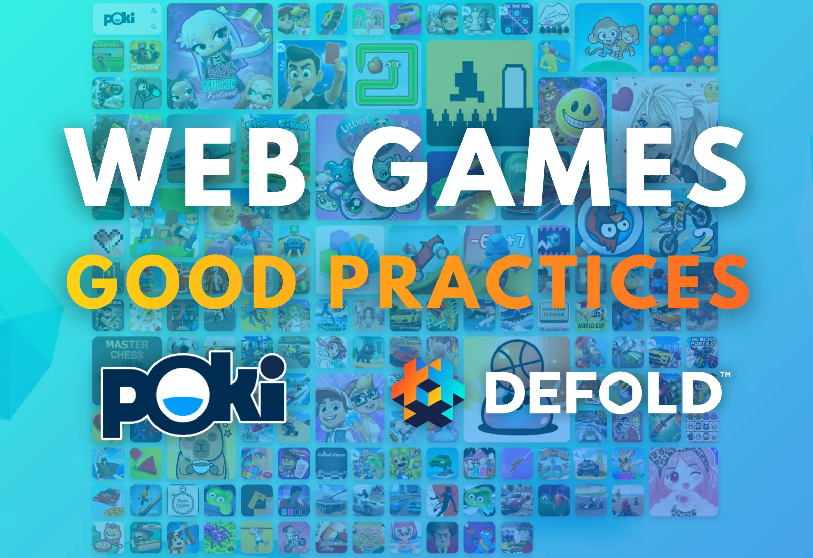
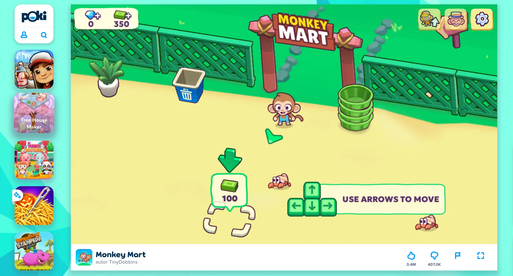
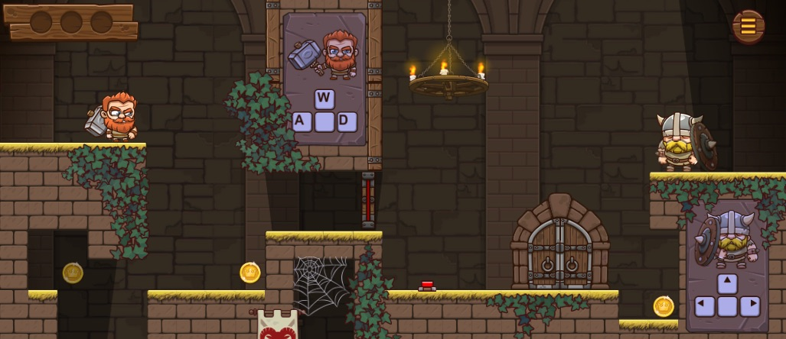
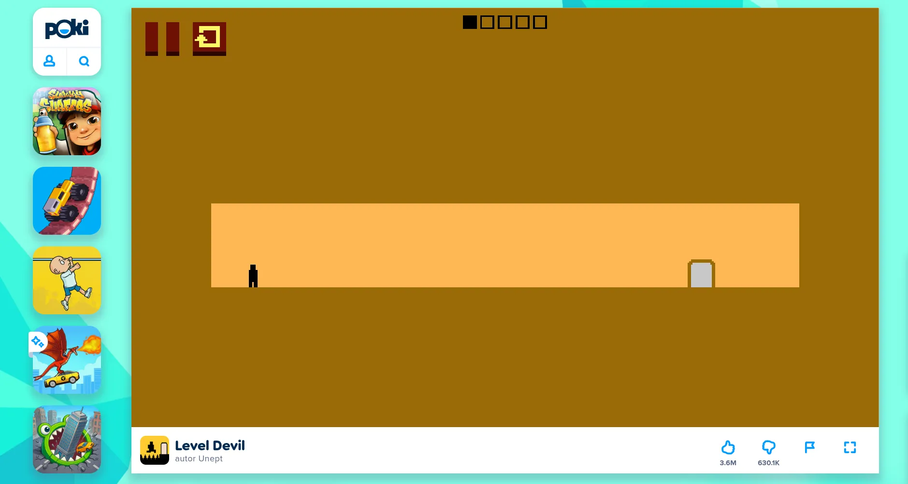
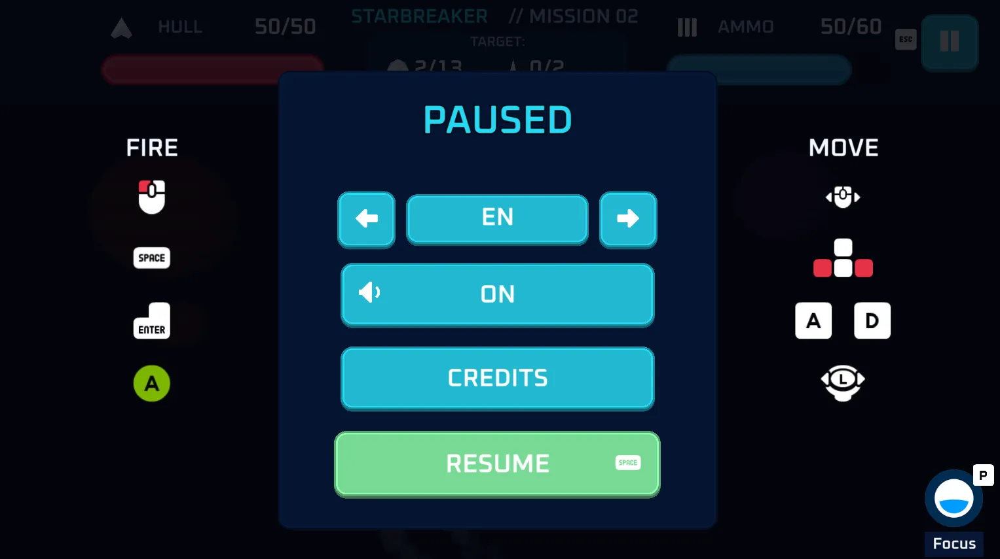
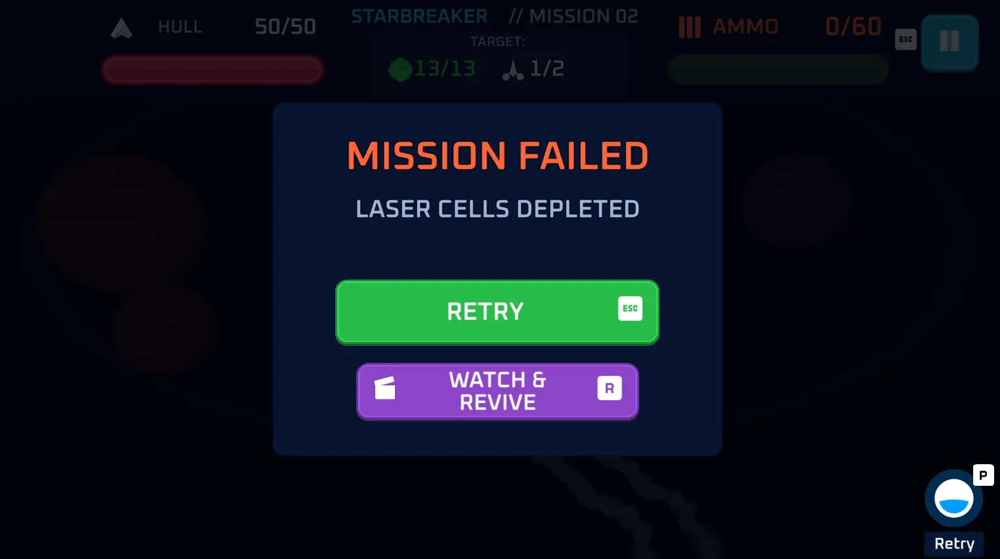
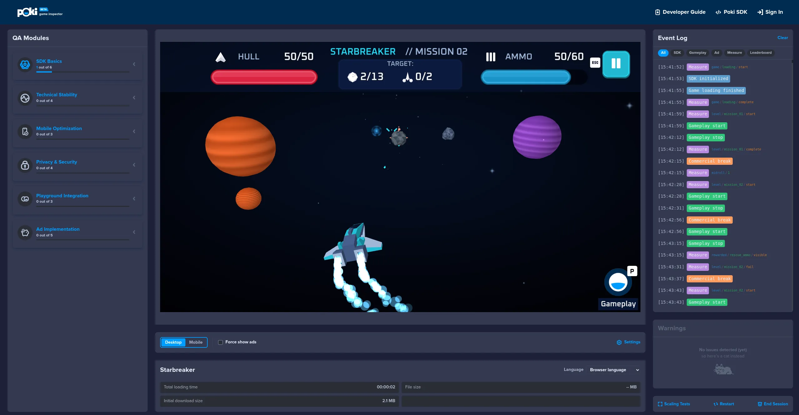

When you launch your own game for the hundredth time, it is easy to ignore its first phase. You know the controls and move through the screens that stand between you and the gameplay without thinking. You may even have saved progress. New players, however, will still be trying to understand what to click and how to play.

*How to succeed on the biggest portal with web games - Poki?*

## First impression

The opening is the most important part of the game. Competition in the web games market is intense, and it is becoming harder to make a game stand out. This is different from the premium game market, where a player who buys a game may already be convinced by a trailer or a review. Players choosing free browser games often judge them by a thumbnail, which is also very crucial, and perhaps by a few seconds of gameplay presented on hover. In the first 10-20 seconds, they decide whether to give the game more of their time. Once you have their attention, make the most of those first seconds.

> **Observe how players behave - from opening the game page to finishing the first round.**

You will see how long it takes to load and start playing, whether it is clear how to begin, what encourages another attempt, and where the first ad might fit. Changing the sequence later may require rebuilding the tutorial, screens, and UI, or even changing the game's economy.

## Understanding the goal of the game

On a player's first visit, show a situation where they can do something interesting straight away. Usually, a visible goal and perhaps the first obstacle are enough. In a platform game, it might be a gap to jump across. In a shooter, it might be a target to shoot or the first enemy. In a shop-management game, the first task might be picking up a product and putting it on a shelf. Level selection and an upgrade shop can come later.

*Monkey Mart is a shop-management game made with Defold. When you open it, you immediately see a simple goal. [Read our interview with its creators](/2023/03/22/Monkey-Mart-is-bananas/).*

Also show an achieveable longer-term goal. It could be a character to unlock or a bonus level for collecting all the stars. In our [interview with Flazm](/2021/06/01/Developer-Case-Study-Flazm-and-Poki/), Alexey Davydov described gently introducing players to the first five levels of the Duo series, then adding new challenges and mechanics. A bonus level gave players a reason to collect stars. The level structure supported both the pace of learning and an additional goal.

*Duo Vikings is a platformer game made with Defold. [Read our interview with its creators](/2021/06/01/Developer-Case-Study-Flazm-and-Poki/).*

Show a hint for the action the player needs to take at that moment. If jumping solves the first problem, show the key or gesture beside the obstacle. Introduce the next ability when the player has a chance to use it. This also keeps the amount of text players need to read and translate to a minimum. Poki shows examples of this approach in its [onboarding guide](https://developers.poki.com/guide/easy-access).

## Mastering controls and rules

Give players time to master the controls, and reduce frustration caused by not knowing how to use them. In our platform game example, after the first failed attempt we could return the player to the obstacle quickly. A full failure screen, reloading the level, and replaying it would only make learning take longer. *Level Devil* is an extremely punishing and trolling platform game, yet it lets players try again straight away without a loading screen.

*Level Devil is a troll platformer game that is easy to read and doesn't need an explanation of its controls.*

It is also a good example of how simple, familiar mechanics do not need an explanation or tutorial. Platform games have existed for decades. When players see a character and a goal, with no distracting elements, they will try to reach it and may test the arrow keys first.

> **Often, intuitive actions do not need to be presented explicitly, but only when the game is clear enough for that to work.**

In the first level of *Level Devil*, the goal is the only thing visible. There is no need for a control pop-up or an explanation of what to do, and the game can still surprise the player.

For more complex games, explain the controls and make a control diagram available in the options or pause menu. This helps both new players and returning players who need a reminder. Simple icons showing the input and the action are usually best. Add explanatory text only if the pictograms are not enough, and localize it into as many languages as possible. The Poki audience is international.

*It's good to present controls or input actions with simple icons, and make them accessible from the pause menu or a pop-up.*

Use Poki Playtests to observe where players get stuck. Those are the moments to find before release. Choose one problem visible in the data and recordings. You might shorten the route to the first move, improve a hint, or change when a reward offer appears. Then compare the versions.

## Loading the game

In our earlier article, [Best practices when building for the web](/2026/06/02/Best-practices-when-building-for-the-web/), we suggested a target below 20 MB. This is a useful working budget, but aim for a smaller initial download where possible. Poki Inspector reports the initial download size. A smaller initial download can make the game start sooner and save valuable seconds of the time players give your game.

Measure the time from opening the game page to the first interaction on the devices and connections your players will actually use. Test with the browser cache disabled. Repeated launches on a development computer can hide the cost of the first download. If loading takes several seconds or more, use that time to show the game's logo, an instruction screen, or a tip. It is also good to show loading progress.

To speed up loading, reduce the game size by compressing textures and audio. Consider making resources that are only needed later available for download through [Live Update](https://defold.com/manuals/live-update/). The first level must still include everything it needs to work. Content that is not shown at the beginning can be loaded asynchronously later, during gameplay. Remember to handle errors and allow players to retry if a download fails.

## Mobile devices

Test your game on mobile devices as well. Close to half of Poki's players use Android or iOS devices, according to its [player device report](https://developers.poki.com/guide/player-device-report), making mobile an important target. Adapt your game for mobile and touch controls. Check that a finger does not cover important information and that buttons remain comfortable to use when the game area changes size.

Poki allows mobile games in portrait, landscape, or both orientations. It [recommends supporting portrait](https://developers.poki.com/guide/easy-access), which also makes Gamebar Display ads available. Consider orientation when designing the camera framing and interface. Test on as many real mobile devices as possible, so that important information does not appear beneath notches, camera cutouts, rounded corners, and similar areas, and use Poki Playtests to see how players interact with the game on mobile devices.

## Completed level

Some games are continuous, such as idle, management, and strategy games. In action, skill, arcade, racing, and puzzle games, players often need a moment to rest. Games may be divided into levels, rounds, or stages. At the end of a round, show players what they achieved and what they can do next. An action or puzzle game might show a score or rating. You can also show how many items the player collected and preview the next stage.

Put the **Retry** or **Continue** button somewhere visible and easy to find. If the game uses a keyboard, let players activate it with a key too. Make the route from failure to another attempt short, especially when rounds are brief. Returning to the main menu and selecting a level can be particularly frustrating for someone who is learning a difficult section.

*After failing, show what can players do next, or offer them a bonus for a rewarded ad*

In its [engagement guide](https://developers.poki.com/guide/engagement), Poki suggests short, repeatable loops of around three minutes as a good starting point. Adjust the length to your game. The important thing is to give players time to understand the task, try to complete it, and see the result.

These moments can also be good places for commercial breaks.

## Advertising when returning to gameplay

When designing your screens, mark the places where players finish a round, view the result, and decide to continue. That decision is an opportunity to call <code>poki_sdk.commercial_break()</code>.

A typical flow might look like this: the player loses, you stop gameplay and send <code>gameplay_stop()</code>, then show the result. When the player clicks **Retry**, request a commercial break. Wait for the call to finish, then begin the next attempt and send <code>gameplay_start()</code>. This sequence is described in the [Poki events documentation](https://developers.poki.com/guide/sdk-overview).

Opening the pause menu or showing a results screen does not mean the player has decided to continue. Place the ad call on the route back into gameplay. Skip it on the player's first entry. After a rewarded break, return to the relevant screen or gameplay without immediately requesting another ad.

Poki manages ad frequency. Report the appropriate opportunities, but do not implement your own timer to control frequency. You do not need to worry that ads will be too frequent for players who, for example, complete levels quickly. Some calls will finish without showing an ad. The game must continue correctly in that case too. Read more in [how Poki monetization works](https://developers.poki.com/guide/how-monetization-works).

## Rewarded video with a specific benefit

Place a rewarded ad offer where its value is clear and meaningful to players. After failing, it might offer an extra attempt. After a completed round, it might offer extra coins, a reward, or a score multiplier. In a puzzle, it might provide a hint for the current problem. Poki collects examples in its [monetization guide](https://developers.poki.com/guide/monetization).

Describe the result on the button - for example, “Watch an ad and return to the game with one life” - or show the reward with an appropriate icon. Players should understand both the benefit and the condition for receiving it. The layout must also meet [Poki's requirements](https://developers.poki.com/guide/requirements-quality#advertisement-integration). A rewarded button must have a clear video icon and must not be green. It is best to assign the usual keyboard confirmation to the standard action.

Design a normal way to continue playing that does not require watching a rewarded video. The standard option must appear at the same time as the rewarded offer, be at least as large, and be beside or above it.

Check the offer against the whole progression. For example, a revive can save an attempt where a player was close to a record. But if beginners regularly need it in the first levels, review the difficulty. The core game should remain accessible without watching rewarded videos.

After a player successfully completes a rewarded ad, show the benefit and apply it straight away when possible. Making players visit a shop just to collect an upgrade they already selected adds unnecessary time away from the game.

## Ad handling is part of the game state

Before requesting an ad, stop the game world and block controls, for both commercial and rewarded breaks. Make sure not to start multiple calls on repeated taps on the button. Wait for the final callback status, including when no ad is shown. Do not send additional gameplay events or measurements through <code>measure()</code> while the ad is playing.

In the Defold extension, grant the reward exactly once, after <code>REWARDED_BREAK_SUCCESS</code>. And when the <code>REWARDED_BREAK_ERROR</code> occurs, we should leave the player with the normal way to continue. Check both outcomes. Unlocking an item from a menu may return the player to the menu. Reviving a character requires preparing it and resuming the game safely.

Function <code>gameplay_stop()</code> tells Poki that gameplay has stopped. You must handle stopping the simulation in Defold separately. Game audio should be muted during an ad, and the player's previous settings should still apply afterwards. From version 3.3.0, the extension automatically mutes audio during ads. See the [Poki SDK guide for Defold](https://github.com/defold/extension-poki-sdk/blob/main/docs/index.md) for callback details and handling breaks.

Use [Poki Inspector](https://developers.poki.com/guide/inspector) to check event order and behavior during pauses, browser-tab or window changes, and ads.

*Use Poki Inspector to verify if events and ads work properly.*

## Saving game state

Make sure your game saves its state. Preserve completed levels, unlocked items, and audio settings. Also remember whether the player has completed the tutorial. Test what happens when the browser denies access to storage. A save error should leave the current game session playable. Handling limited storage access is part of [Poki's requirements](https://developers.poki.com/guide/requirements-quality).

When the player reopens the game, offer a way to continue and show the goal they were last working on. Keep the controls available for review, for example in the pause menu.

You should also measure whether players return the next day. If you want to evaluate day-one retention (D1), measure the share of new players who return the following day, using the same definition in every version you compare. Average playtime alone will not show this.

Play through the first visit with an empty save, then return with progress saved. Repeat the test on a phone and with an ad blocker enabled. Separately test a rewarded ad that grants its reward, a request that does not grant a reward, and rapid repeated taps on the offer.

## Poki Events

In Defold, call <code>poki_sdk.gameplay_start()</code> when the player's first deliberate input and movement begin gameplay. Clicking in an interactive tutorial is already part of gameplay. A screen or pop-up with instructions that is waiting for a click is still a waiting state. This distinction matters for [SDK measurements](https://developers.poki.com/guide/sdk-overview). Send start and stop events when the game changes state, and avoid sending two starts or two stops in a row. This is an error that will be reported in Poki Inspector.

Add a few tracking events to your game. For example, <code>poki_sdk.measure()</code> can track when the tutorial starts and finishes, as well as attempts to complete later levels. For one attempt, send <code>start</code>, followed by either <code>complete</code> or <code>fail</code>. For rewarded offers, the <code>visible</code> and <code>interact</code> pair shows how often an offer is displayed and how often it is chosen. The SDK tracks ad playback and its result automatically. These patterns are described in the [Game Events documentation](https://developers.poki.com/guide/game-events).

Read the results together with recordings. A low Conversion to Play (C2P) - the share of visitors who reach their first <code>gameplayStart()</code> - points to loading and the route into the game. If players drop off at a specific level, watch that part. You may find a sudden jump in difficulty or an unclear instruction.

[Poki gives](https://developers.poki.com/guide/reading-results) general targets of at least **65% C2P** and an average of at least **five minutes of playtime**. For management and simulation games, the target is at least **ten minutes**. Results also depend on genre and the stage of testing. The [Player Fit Test](https://developers.poki.com/guide/player-fit-test) has its own threshold for progressing: an average of more than three minutes and at least 25% of sessions lasting longer than three minutes. C2P is measured only later, in the Web Fit Test.

## Summary

A strong first session helps new players understand what to do, gives them time to learn the controls, and makes it easy to continue after a round. Test the complete journey - from the first load through the first attempt and the next decision - on the devices your players use. Then use playtests, recordings, and events to find where they struggle and improve one thing at a time.
