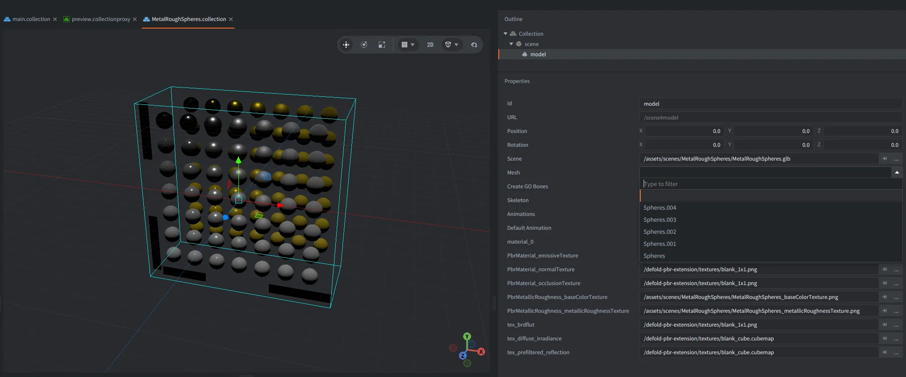
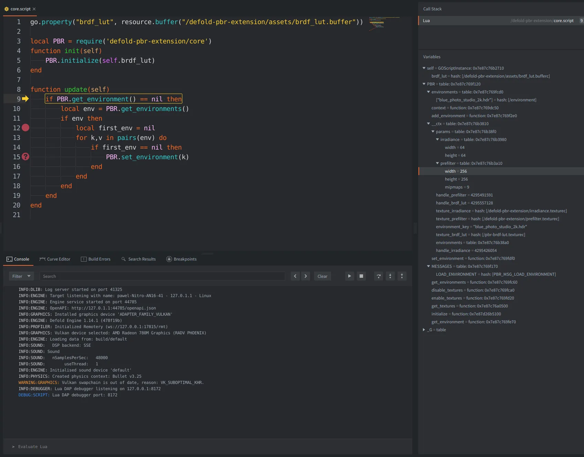

**Defold 1.14.1 is now available!** This version brings major improvements to text rendering with runtime vector fonts and support for emoji, 3D asset workflows, debugging, engine performance, and the native Lua debugger. It also makes particle effects and game object updates faster, adds built-in MP4 recording for desktop debug builds, and introduces several useful improvements for HTML5, mobile, and everyday work in the editor.

## Highlights in Defold 1.14.1

* **Runtime vector fonts** for sharp text, with new font configuration and dynamic glyph generation
* **Improved glTF and PBR workflows**, including support for Draco/Meshopt-compressed glTF assets and KTX2 textures
* **Native Lua debugging using DAP**, with breakpoints, stepping, variable inspection, and evaluation
* **Faster particle effects and game object transforms**, with less work spent generating and updating geometry
* **Built-in MP4 recording** for desktop debug builds
* **Graphics backend selection on Windows** through the App Manifest: OpenGL, Vulkan, or DirectX 12
* **More flexible tile source animations**, with frames in any order and repeated frames
* **Resource loading timings in the profiler**, making slow-loading assets easier to identify
* **HTML5 pixel ratio limits** and a new way to identify the source of input actions
* **Editor improvements**, including a Scene View axis gizmo and reduced VRAM usage for inactive tabs

## Crisp text with runtime vector fonts

Defold 1.14.1 introduces [runtime vector font rendering](https://github.com/defold/defold/pull/13197). Instead of relying only on pre-generated distance-field textures, vector fonts can render sharp text across different sizes while using fewer texture resources in many cases.

Font resources now provide more control over rendering and glyph generation. You can choose between **SDF** and **Vector** rendering modes, and configure whether glyphs are generated at build time or dynamically at runtime. Vector fonts use the Slug rendering approach, while outlines and shadows continue to use bitmap-based techniques.

Existing font resources using SDF rendering continue to work as before. Newly created font resources default to Vector mode. **Vector rendering requires newer shader features and does not support OpenGL ES 2.0 or WebGL 1**, so be sure to check your target platforms before switching it in your project.

## Better glTF and PBR workflows

The editor now lets you expand `.gltf` and `.glb` files in the Assets view to browse their meshes, materials, and images. When previewing or adding a model, Defold can use the materials and textures defined in the source file, reducing the amount of manual setup needed to get a model looking right.

Defold also adds support for importing [Draco- and Meshopt-compressed glTF files](https://github.com/defold/defold/pull/13048), along with KTX2 textures referenced by glTF assets. This improves compatibility with common 3D content pipelines. The compressed glTF support applies to reading and importing assets. Note, that it does not mean the engine now performs Draco or Meshopt decompression at runtime.

You can still assign custom materials, and editor scripts can inspect resources contained within an asset using `editor.resource_children()`.

## Native Lua debugging

Defold's Lua debugging workflow now uses a native implementation of the [Debug Adapter Protocol (DAP)](https://github.com/defold/defold/pull/13321). The debugger supports breakpoints, stepping through code, inspecting and editing variables, and evaluating expressions across script contexts and coroutines.

The Defold editor has also switched to this native debugging backend, improving the integration between the engine and editor. External DAP-compatible tools can connect to a debug engine as well, making the debugging system more flexible for different workflows.

## Faster particles and game object updates

This release includes substantial performance work in two areas that may be especially useful in projects with many objects and effects.

[Particle effect optimizations](https://github.com/defold/defold/pull/10039) make the built-in particle vertex format more compact and significantly reduce the time spent generating particle vertices. In our 200,000-particle benchmark on an M1 Pro using Metal, vertex generation was approximately **94–95% faster** for the tested default materials. Overall frame-time improvements will depend on the scene, particle simulation, and hardware.

[Game object transform updates](https://github.com/defold/defold/pull/3178) have also been optimized. In the measured 100,000-object scenarios, transform and animation update work improved by approximately **1.17–3.25×**, depending on the test. These improvements can help projects with large numbers of moving or animated objects, although the impact on total frame time will vary.

## Record gameplay directly to MP4

Defold now includes [native MP4 video recording](https://github.com/defold/defold/pull/13501) in desktop debug engines, replacing the previous VP8/IVF recording format. You can start and stop an H.264 recording from Lua using the new `recorder` module, or control recording through the engine's HTTP service.

This is useful for recording gameplay, documenting bugs, or capturing footage while developing your game. Supported macOS and Windows environments can also capture application audio. Linux recording is video-only.

## More control over input, HTML5, and mobile layouts

Input callbacks now include an `action.source` value, letting you distinguish between input coming from the mouse, touch, keyboard, gamepad, and other supported sources. This can be particularly helpful when a touch event simulates a mouse click.

HTML5 projects can now [set minimum and maximum pixel ratios](https://github.com/defold/defold/pull/8040) when High DPI rendering is enabled. This makes it possible to cap rendering resolution on high-density displays or configure supersampling without changing the size of the canvas on the page.

On mobile, `window.get_reserved_areas()` provides information about camera cutouts and other reserved display regions on supported iOS and Android versions. The release also improves orientation handling, Android controller mappings, and iOS Home Indicator configuration.

## Editor improvements

Tile source animations are now more flexible. Instead of specifying only a start and end tile, you can define frames individually, use ranges, repeat frames, and play them in any order. For example, `1, 3-5, 8, 3` can be used without rearranging the tiles in the source image.

Other editor improvements include a new **Scene View axis gizmo**, less VRAM used by inactive Scene View and code tabs, and better handling of deleted or externally modified files. Desktop game windows launched from the editor can also remember their position and size between runs.

## Other improvements

The resource profiler now includes [per-resource loading timings](https://github.com/defold/defold/pull/9887), with a breakdown of loading, preloading, reading, and creation time. These measurements make it easier to identify assets that contribute to slow startup or loading sequences.

Windows games can now select **OpenGL, Vulkan, or DirectX 12** in the App Manifest, with OpenGL remaining the default. Sound playback also offers per-voice gain and pan control, giving you more flexibility when several instances of the same sound are playing.

Debug and headless engines now expose OpenAPI discovery for their runtime services, making it easier for external tools to discover supported endpoints. This release also includes graphics and model optimizations, improved HTML5 loading behavior, and faster texture processing in applicable build workloads.

## Breaking changes and migration

**Defold 1.14.1 changes the default handling of OpenGL ES 2.0 and WebGL 1 shaders.** These legacy shader targets are now excluded by default to make it easier to adopt newer shader features, including vector fonts. If your project still needs those targets, review the **Exclude GLES 2.0** setting in `game.project` and turn off that exclusion as appropriate. Remember that vector fonts themselves do not work on GLES 2.0 or WebGL 1, and there is no automatic SDF fallback for unsupported devices.

A few additional changes may need attention in existing projects:

* **Custom iOS `Info.plist` files:** Review the updated template if you use custom orientation settings, and add `UIApplicationSupportsIndirectInputEvents` where required by the new input-source behavior.
* **Native extensions using the engine web server:** `dmWebServer::AddHandler()` now takes an additional OpenAPI Paths Object argument. Extensions calling this API must be updated.
* **Projects upgrading their fonts:** Existing SDF fonts continue to work, but newly created fonts default to Vector mode. Test font rendering and compatibility on your target devices.

As always, use source control before updating, and build and test your project on all target platforms. See the complete release notes for details about changes that may affect your setup.

## Get Defold 1.14.1

[Download Defold 1.14.1](/download/) and give the new features a try! Thank you to everyone who contributed code, tested the beta, and reported issues along the way.

See the full [Release Notes](https://forum.defold.com/t/REPLACE-WITH-1-14-1-FINAL-RELEASE-NOTES) for the complete list of new features, improvements, fixes, and migration details.

### Support Defold

Defold is provided completely free of charge. If it helps you build your games, consider [supporting the Defold Foundation](/donate/) to help fund continued development. You can also support Defold by spreading the word, contributing code, testing releases, or helping other developers in the community. Thank you for helping us make Defold better with every release!
