In the Creator Spotlight posts we invite Defold users to introduce themselves and share their background, projects and experiences with the engine. It is an opportunity to celebrate the work of the community and learn from the people making games with Defold.

This time we spoke with Jaden, co-founder and engineering director of [Snowfall Games](https://snowfall.games/), about [Portentum](https://store.steampowered.com/app/4836460/Portentum/), a free-to-play cryptid-themed card battler that launched in Early Access on Steam on October 28, 2026. We discussed the studio's path from *StarCraft II* mods and Fortnite games to its own original title, why the team chose Defold, and how it built a custom UI pipeline, asset streaming and asynchronous multiplayer around a lightweight game client.

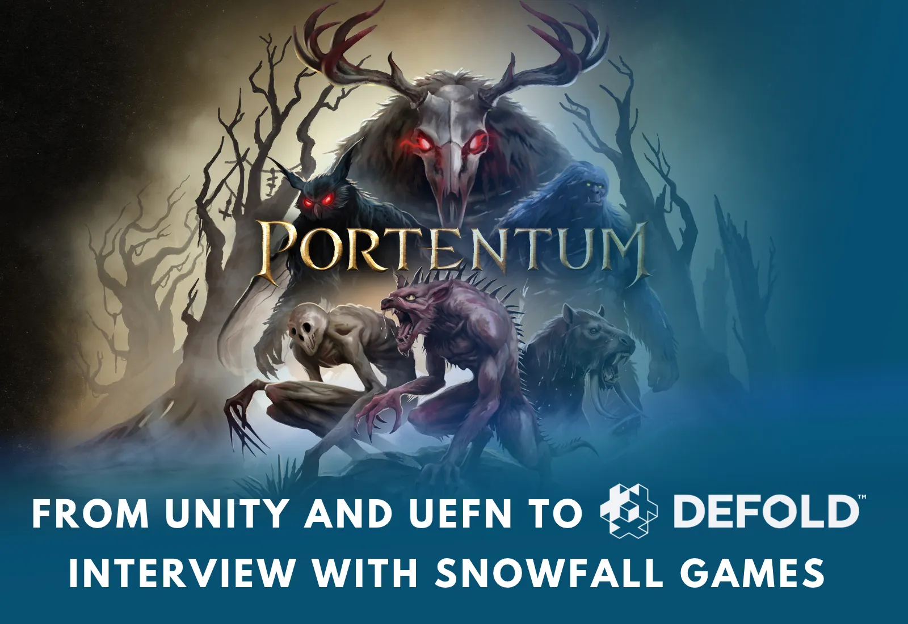

_Portentum, a cryptid-themed card battler made with Defold by Snowfall Games_

## Introduction and background

##### Hi Jaden! Please introduce yourself and Snowfall Games to the Defold community. Who are you, and what does the studio make?

Hi, I'm Jaden! I'm a co-founder and the engineering director of Snowfall Games, a small indie studio of just five people, with two of us full-time. Our newest game, *Portentum*, launched in Early Access on Steam on October 28. In *Portentum* you collect cryptids like Bigfoot, Mothman and the Jersey Devil, build them into a deck, and roll dice to fire off their abilities in battle. We built it in Defold.

My co-founder, Austin Reeve, is our art director and a friend I've known since we were kids. We're primarily a team of engineers, and we collaborate with artists from around the world to help bring our games to life. Before *Portentum*, we made around 14 games for Fortnite, and they've been played more than 9 million times.

##### We know you started making games through StarCraft II mods and had thousands of people playing them while you were still in high school. How much did that experience shape the developer you became?

It shaped me a lot. I worked on some of the top *StarCraft II* mods at the time, including *Marine Arena 2* and *Biodefense: Zerg Outbreak*. The adrenaline of thousands of people playing my mods is a high I've been chasing ever since.

Modding also showed me how much tooling matters when you build a game. *StarCraft II* gave me the same tools Blizzard's team used to build the official campaign. After all my years of modding, I learned to tell good tooling from bad, and today we build tons of tools at Snowfall. We arguably have more tools than we have games, but that's going to change in the coming years!

##### So you and Austin have known each other since childhood, long before Snowfall existed. How did you start a game studio?

Austin and I go way back. Every Halloween we turned our parents' garage into a neighborhood spook alley. We cut refrigerator boxes into a maze of walls, and one year we even added pressure pads that set off a garden hose in your face, hidden behind a big spider prop.

Eventually we started messing around in Unity together. Once we found out we could build digital worlds, where we weren't limited by our lawn-mowing money, we never looked back. We've since spent years developing our skills professionally so we can make games we're proud of, and Austin and I made countless learning projects along the way that never went public. During COVID, after we'd both grown up and gotten day jobs, we met back up to start the kind of studio we wished existed.

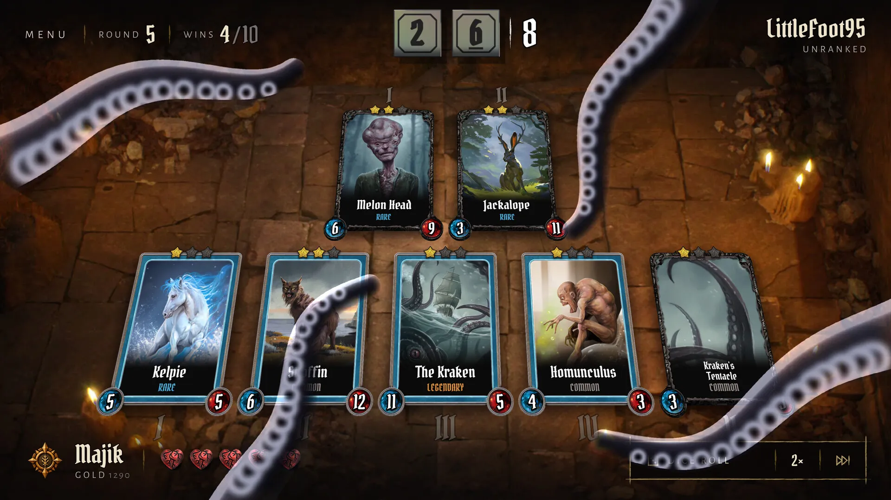

_Kraken tentatcles effect in Portentum_

## Building a studio

##### Snowfall describes itself as "small on purpose." What does that mean in practice? Is five people close to the studio's ideal size, or do you want to grow further?

The dream is a place where we enjoy what we do for a living and still get to go home and enjoy our families. Life is short, and we'd much rather spend those hours creating than working a corporate job. Pitching investors, chasing an IPO and getting grilled by a board of directors just doesn't sound fun. If an IPO were the goal, there are much easier paths than the unpredictable and difficult games market.

Five people is about the size we want to be. Our goal is to get all five of us working on Snowfall full-time and then stay small.

##### *It Was You* has been in development for around six years. Looking back, what did that project teach you about game production?

When we started *It Was You*, I don't think we knew just how little we knew about game design and game development. We would spend a week building a mechanic, playtest it with the team the next week, and find out it was super boring. We rewrote our network stack a few times, changed render pipelines trying to reach the vision we had, and reworked the core game loop over and over.

Looking back, I think we spent five of those years in that cycle of iteration, and we came out the other end knowing a hell of a lot more about game engines, netcode and game design. Every year we told ourselves we'd ship the next year. It sucked, but that's when everyone on the team grew the most.

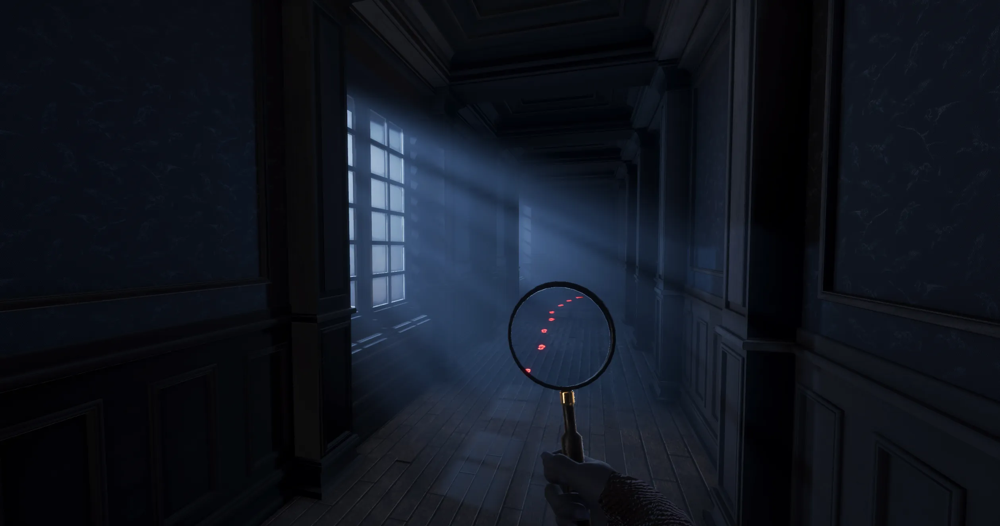

_It Was You by Snowfall Games_

##### A year talking to 28 publishers and eventually signing with none of them - did it change how you think about funding games? What would you recommend to other developers approaching publishers?

Yes. Right now, I don't think game funding makes sense. Publishers are in a tight spot trying to predict winners, and there's an abundance of developers seeking money. When I pitched *It Was You* in 2024, we found out the terms aren't all that favorable to developers. One publisher, who had never played the game, offered us a 90/10 revenue split in their favor until they recouped their investment, then 80/20 until they doubled it, 70/30 until they tripled it, and 50/50 forever after that. We were able to say no and walk away, because we hadn't scaled up to the point where walking away would mean layoffs. I feel bad for the studios taking worse terms just to keep the lights on.

My advice is to think hard about how to build a sustainable income as a game studio. Don't make one big bet. Spread your risk across several smaller ones. For us, that's our Fortnite games, *Portentum* and *It Was You*. I think funding should follow the same mentality.

##### How important was the pivot to platforms such as UEFN and Discord Activities in keeping the studio going?

The pivot mattered a lot. When every publisher thread ran out, we went into what we called "throwing darts mode," where anything that could get us a win fast was on the table. In the fall of 2024, I went to Unreal Fest in Seattle, walked up to the UEFN booth and asked whether there was any real money in it. The Epic rep pointed me to a group of young creators, and one of them pulled up the payout estimates for the top UEFN creators. The numbers were six and seven figures. I called Austin from the convention floor, and before I finished explaining, he had UEFN open on his screen.

A week later, *Hunt Bigfoot* was live on Fortnite. Our Fortnite games took the team's income from zero to something, and that let us bring on a second full-time teammate.

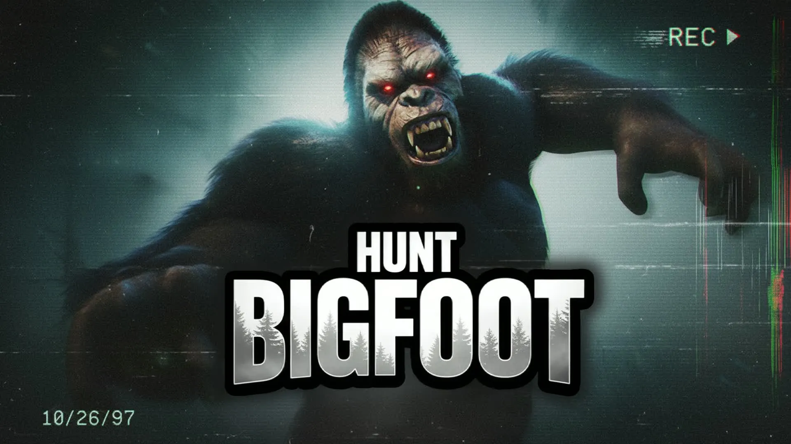

_"Hunt Bigfoot" became a breakout success for Snowfall Games on Fortnite_

##### *Hunt Bigfoot* went from almost nobody playing it to more than 36,000 concurrent players after one update. What was that moment like, and what did you learn from it?

For a month or two, *Hunt Bigfoot* was a dud. Then Fortnite added a first-person camera device to UEFN, along with a discovery row for games that used it, and Austin saw an opportunity. He added first person to *Hunt Bigfoot* on a Friday, and at 2 AM the next Tuesday he posted "top 100 map rn" in our Discord. The next morning, the five of us piled into a voice channel called the Bigfoot Lounge and watched the player count climb. It peaked at 36,471.

I'd felt that high once before, as a kid watching strangers pile into my *StarCraft II* mods. Back then I was alone in my bedroom at 2 AM. This time I was with my team, and nobody wanted to leave the call.

What I learned is that you can't predict which game will take off. We've tried, and we've been proven wrong time and time again. That's why we start small, ship, learn and iterate.

##### After more than 9 million plays across your Fortnite games, why was it important to return to games you own and distribute yourselves?

It's the same idea as my funding advice: make multiple bets. Going all-in on Fortnite worked for a while, but it didn't last. We don't control our own growth there. When Epic changed the payout formula in November 2025, one of our games made about 40% less money with the same players and the same retention. Launching our own games outside of Fortnite gives us more control of our destiny.

## From cryptid legends to cards and dice

##### It seems cryptids have become something of a Snowfall specialty! Did *Portentum* start as a cryptid game, or did the theme come after the card-game concept? And how did you arrive at the combination of cards and dice?

The card game came first. Matt, our lead game designer, is a serious card game player. We started making a card game as a side project, and it turned into our main project. Cryptids were the obvious theme, because *Hunt Bigfoot* is what broke us out on Fortnite and players kept asking us for more cryptid games.

The dice came from me. I love *Balatro*, and manipulating dice felt like the same itch as manipulating your deck. In *Portentum*, abilities trigger off what you roll. One card reads "Deals 3 damage to a single enemy when dice sum is 7 or higher," and other cards let you change the dice.

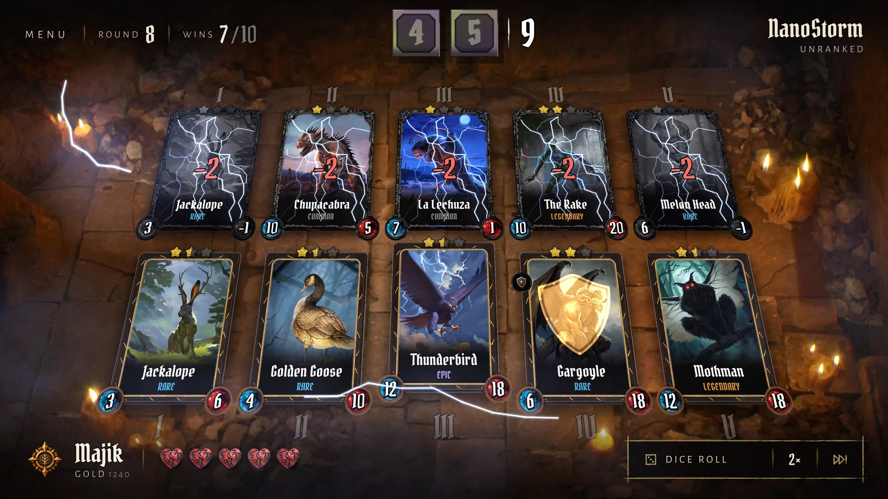

_In Portentum, cryptid abilities trigger from dice rolls, and other cards can manipulate the dice_

##### I like that the cryptids aren't just different skins and their folklore actually dictates their abilities. How do you decide which legends can make good cards?

That's Matt's department, and he wrote a dev blog post about it called ["A Cryptid to a Card"](https://snowfall.games/blog/a-cryptid-to-a-card). His rule is that the best mechanics start with a flavor win. If a player can point at a card and say "that feels like the Rake," then the card works. In the legend, the Rake stays silent and still for a long time before it attacks. Matt turned that into a card that gains `Threat` on every dice roll. Once the Rake is the most threatening card on the board, it hits hard on every roll.

## Why Defold?

##### After years of working in Unity, Unreal and UEFN, how did Defold become a consideration for *Portentum*? What ultimately made it the right choice?

Speed was the first reason. One of Matt's biggest gripes is how long *Hearthstone* takes to launch on mobile, and Fortnite taught us that games that load fast and run well everywhere do better.

<i>“We want the gap between deciding to play and actually rolling dice to be as close to nothing as we can make it, and Defold let us keep the whole game lean.”</i>

Defold is also really developer-friendly, which counts for a lot when your team is small and everyone is doing three jobs at once.

The license is another big reason. Defold is completely free, with no royalties, no revenue share and no runtime fees, and a non-profit foundation runs it under a charter that requires it to stay free. For a small studio, an engine that will never take a cut of our work is a wonderful thing to build on.

Overall, Defold checked all the boxes. A lot of the time, after you finish a game, you get tired of the engine and tools you used, and the grass starts to look greener somewhere else. I feel the opposite.

<i>“Even after shipping Portentum, I can't think of a better engine for it.”</i>

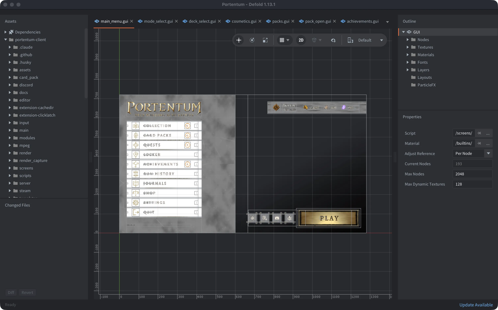

_Main menu of Portentum in Defold editor_

##### Could you share a specific example of where Defold made development easier or faster compared to Unity or Unreal?

Iteration times in Defold are extremely fast. One of our biggest complaints in UEFN was the iteration time from a change to getting to play mode. We actually opened a forum post with Epic regarding that.

So when we looked for an engine, we wanted something lightweight where the time from a change to playing and testing took only seconds.

<i>“Defold is wicked fast, and we love the ability to use Lua for scripting, or break into the engine-level code in C++ when we absolutely need performance.”</i>

Its flexibility and public source code made it a clear winner for us.

##### Was there anything you initially missed in Defold, or anything you were surprised you no longer needed? Now that you've made a commercial game with it, what would you most like to see improved or added?

UI has been our biggest pain point in every engine we've used. It's really hard to make UI that looks good and also performs well.

<i>“Defold was by far the easiest engine for UI, and I think part of that is how lean and fast it is.”</i>

The one thing I missed was layout tools, so we built our own layout pipeline.

At the top of my wishlist is a native MCP server and tighter AI integrations, especially for automated testing. After that, I'd ask you to keep improving UI. We love the new vector font work, and a built-in layout system would be next on my list.

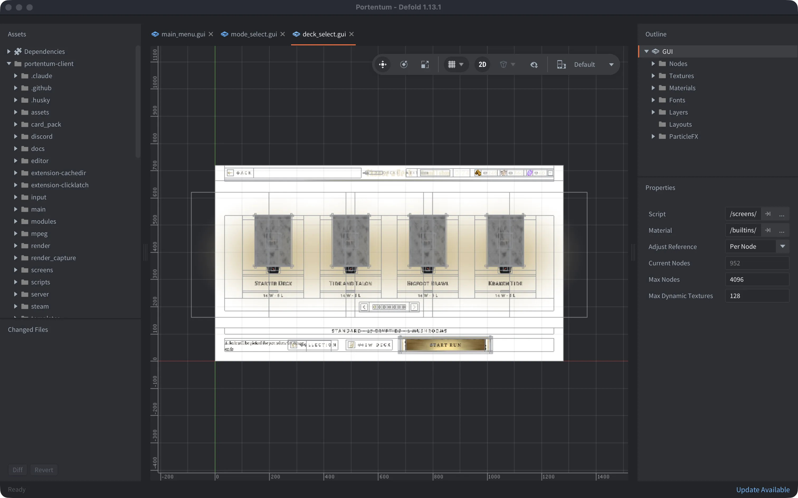

_Portentum deck selection in Defold editor_

##### One of your goals was to make the gap between deciding to play and actually playing almost disappear. *Portentum* can boot really fast. How did Defold help here?

I just timed it after launch, and it's about four seconds now.

Defold helped a lot here. The engine is small, and collection proxies make it natural to load a screen only when you need it. At boot, we only load the screens the game needs to start, and the other 20 or so load in the background.

## Streaming assets, extensions and custom tools

##### You've said that everything in *Portentum* is streamed. What does that look like technically in Defold?

The UI, fonts, shaders and core game code ship in the build. Everything heavy streams in, including card art, cosmetics, music, effect videos and every language except English.

Our API sends the client a URL for each file, and a small asset cache module downloads it with Defold's `http.request` and saves it to disk. The files are hosted on Cloudflare R2, and card art goes through Cloudflare's image resizing, so the client only downloads the size it needs. On first launch, the game downloads about 68 MB of core files in about six seconds. Everything else downloads the first time the game needs it.

##### *Portentum* involves collection management, card effects, UI, online accounts and asynchronous PvP. Which parts were particularly easy to build in Defold?

<i>“Native extensions and talking to our backend were the easiest parts.”</i>

We use a vendored copy of the Steam extension for sign-in, achievements, rich presence and Steam Input, and we use the Discord Social SDK for rich presence on Discord. We also wrote a few extensions of our own. One is an MPEG video player based on `pl_mpeg` that decodes video on a worker thread and converts it to RGB on the GPU. Another is a small macOS fix that catches trackpad taps shorter than a single frame.

Talking to our backend was just as easy. Our gameplay calls are GraphQL requests over `http.request`, and our live tournament mode uses `extension-websocket` for GraphQL subscriptions.

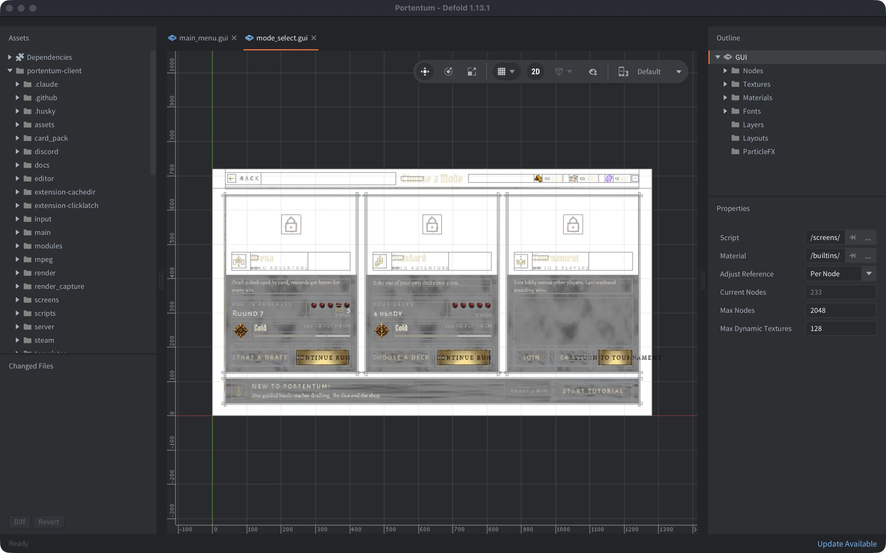

_Portentum mode selection in Defold editor_

##### How does Defold fit into the team's day-to-day workflow? Which libraries, extensions and custom scripts have become essential for *Portentum*?

Druid and Monarch are the two libraries we lean on most. Druid handles UI components like cards, dragging and hover, and Monarch manages our screens.

UI was our biggest pain point, so we built our own layout pipeline. We design each screen in HTML and CSS, headless Chrome reads the computed layout, and a tool turns that layout into a Defold `.gui` file. At runtime, a small flexbox solver written in Lua handles the layout. We've built 38 screens this way.

We test a lot. We have about 6,500 deftest tests, and every pull request runs luacheck, around 30 guard scripts and the full test suite headless with bob.

Our newest tool is our own MCP server, `defold-mcp`. It builds the game with bob without opening the editor, and it drives a running game through the automation bridge extension. It can query the scene, click, take screenshots and record video. With it, AI coding agents can build, test and check their changes in the real game. We also have a small editor script that switches the game between our local, staging and production APIs.

Defold's web build is part of our daily workflow too.

<i>“It was so easy to deploy a change and send the team a link to test it, instead of distributing a desktop executable.”</i>

Building for web also helped us keep tabs on the game's performance, because it's easy to lose sight of performance on our gaming rigs running desktop builds.

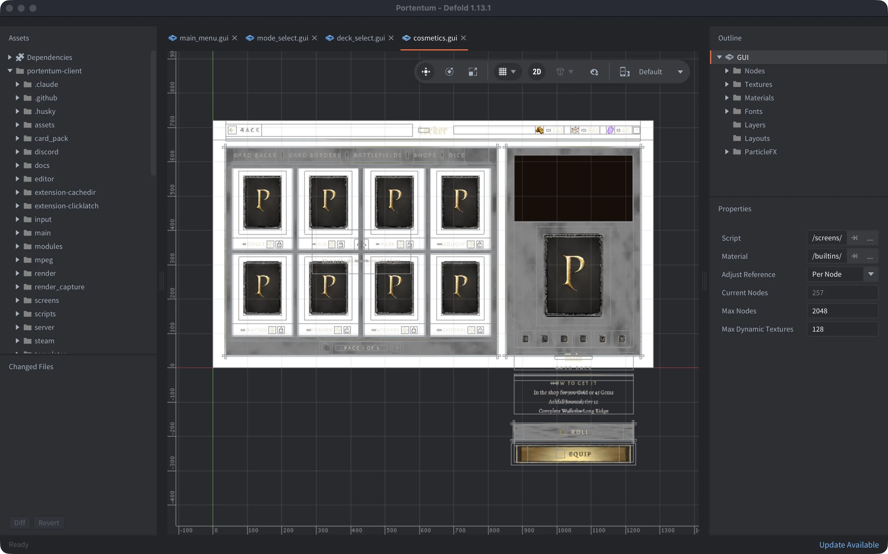

_Portentum interface for cosmetics in Defold_

##### Your HTML/CSS-to-Defold GUI pipeline sounds fascinating! Could you walk us through how it works in practice and why choosing such solution?

We've always struggled with building UI in every game engine we've ever used. A lot of our team, myself included, has years of experience with web frameworks and building websites, and we've always felt frustrated working in a game engine where we lose the awesome rendering capabilities and quick iteration time we have in a browser.

So we built a tool that lets us build our UI in the browser, and then we have scripts that convert it into native UI in Defold (See: [https://en.wikipedia.org/wiki/Intermediate_representation](https://en.wikipedia.org/wiki/Intermediate_representation)). Add agentic workflows as the secret sauce to help carve out this tooling, and it's all pretty magic.

## Multiplayer and cross-platform accounts

##### *Portentum* is multiplayer, but you deliberately avoided traditional real-time matchmaking for its main mode. Why, and how does the system work? What runs in Defold and what runs on the backend?

Asynchronous matches have no queue, so you can play any time without waiting for someone else to be online. That matters a lot for a new game. Async also saves our small team from building and running real-time netcode and servers, and most auto battlers work this way anyway.

Every time you go to battle, a snapshot of your warband joins the matchmaking pool, and you face a snapshot from another player at the same round with a rating close to yours. The game logic lives on our NestJS GraphQL backend. The server rolls the dice, resolves the whole battle in one call and stores it as a list of actions. The Defold client renders the game, handles input and plays those actions back.

We do have a real-time mode too, for tournaments. A host makes a lobby with a join code, and players fight head-to-head each round over a websocket, with `extension-websocket` on the client.

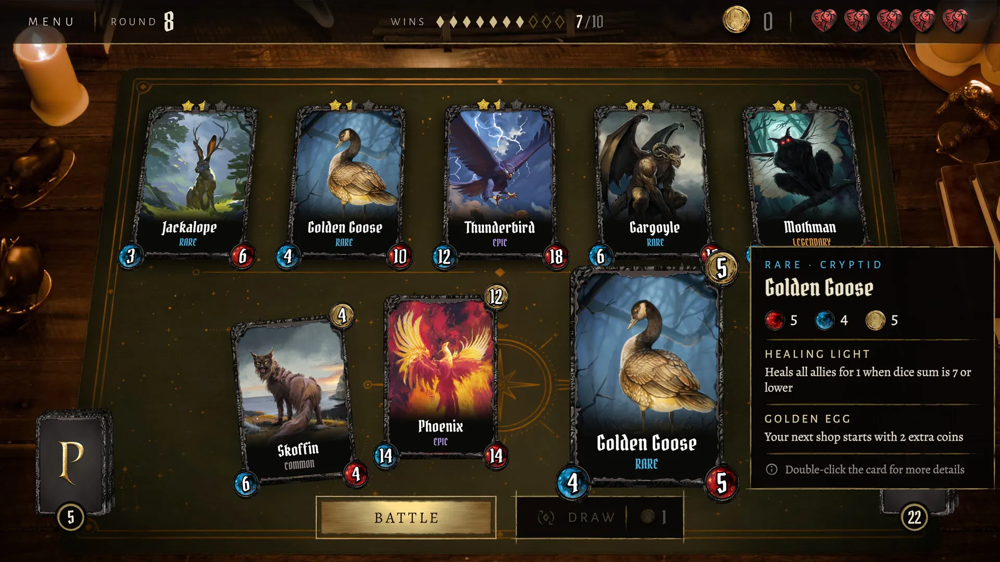

_The Defold client renders battles while the backend resolves game logic and records the actions_

##### How are you approaching cross-platform accounts and persistence? Will players carry their progression and collections between platforms?

We built our own account system, Snowfall accounts, and we've been building it for three to four years. Every *Portentum* player has a Snowfall account, and the same account works across all our games, so your progress belongs to you instead of to a platform. Because we own it, we can customize it to our needs, and we never have to work around a third-party platform to do what we need.

I'm excited to announce here that *Portentum* is coming to Discord Activities soon. We relied heavily on Defold's web build during development, and that made adding Discord Activities easy. Under the hood, a Discord Activity is just a WebGL build. More platforms will follow in 2027, but for now we're focused on balancing the game. Steam and Discord are both easy places to ship updates, which matters a lot while the game is this early.

## Launching Portentum and looking ahead

##### How did attending PAX West and participating in Steam Next Fest went?

PAX West was the first time anyone outside the studio played *Portentum*. It wasn't uncommon to look over and see someone still at a station an hour after they sat down, and a few people came back the next day to try a deck they'd been building in their heads overnight. Close to 40 people from press outlets came by for interviews, and we won two awards.

Steam Next Fest was harder. We didn't see as many wishlists as we hoped, but Next Fest also grew to over 8,000 demos this year, and it's getting harder to cut through the noise. Card games are tough too, because they don't have the same visual appeal as other genres.

Put together, the two events showed us that people don't know how good a card game is until they sit down and try it. At PAX, the people who sat down stayed. Now our job is to get more people into that first game.

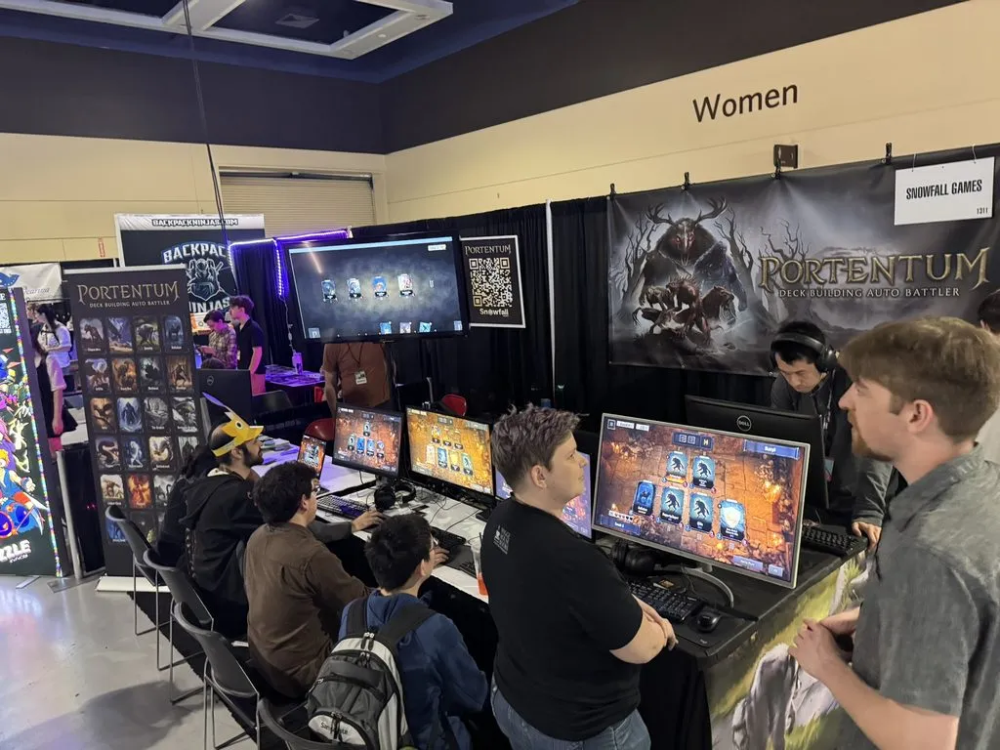

_Portentum being demonstrated at PAX West 2026. Image credits: [Gaming Furever](https://gamingfurever.com/furry-gaming/portentum-impressions-gf-pax-west-26)_

##### You've been open about worrying that "free-to-play" might immediately make people think "pay-to-win." How are you trying to earn players' trust? Where do you draw the line between supporting the studio and hurting the game?

Free-to-play was one of the hardest calls we've made. It keeps the barrier to trying *Portentum* low, but I know a free game with things to buy makes people think pay-to-win.

I draw the line at fairness. Players who spend time with the game are paying with their time, so they should be able to earn what a paying player gets. You can buy card packs with Gold, and the only way to get Gold is to play. Cosmetics never affect battles.

It's completely subjective, but I think we found a good balance. I love players who play enough to earn it all, because it shows how much they love the game, and I want those players to stick around and grow our community.

##### Portentum will be roughly a year in Early Access, right? What do you hope to achieve during that period, and what will tell you the game is ready for a full release?

Early Access made sense because we're still fleshing out the balance, abilities and card set. We didn't want to put the game in players' hands at this point and have them think it was the final product. Early Access is a great way to tell players that we want to keep building this game with the community's input.

We're aiming to leave Early Access by the end of 2027. When we do, I think it will just mean we're happy with where the game is. Ultimately, I hope we never lose the spirit of Early Access: listening to the community and adding more content.

##### Thank you very much for the interview! Finally, where can people follow Snowfall Games, keep up with future releases and play *Portentum*?

Our dev blog at [snowfall.games/blog](https://snowfall.games/blog) is where we write about how we make our games, and our Discord at [discord.gg/snowfallgames](https://discord.gg/snowfallgames) is where we talk with players the most. You can play *Portentum* on [Steam](https://store.steampowered.com/app/4836460/).

Thanks for having us!

##### Thank you, Jaden, for sharing Snowfall Games' story and your experience building Portentum with Defold. We wish the team success with the Early Access release and everything that comes next!
