## News

Hello Defolder!

Lots of jams and events are coming up, and we also have a complete open-source 3D web game sample, new games made with Defold, new assets, plenty of articles about Xbox support and the first video from our jam! If you have something you wish to share, please send us an email at [info@defold.se](mailto:info@defold.se).

## Defold + Minit Game Jam #1

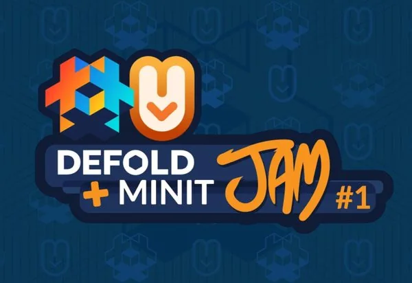

Make a tiny, instantly playable game, publish it on Minit and compete for cash prizes. Submissions close November 10.

[Join the jam](https://forum.defold.com/t/defold-minit-game-jam-1/83382)

We also support jams by Haven Hack Club and Mumukshu Labs, plus a free onboarding webinar on November 6!

[More jams & webinar](https://forum.defold.com/t/defold-foundation-supports-haven-hack-club-and-mumukshu-labs-game-jam-events/83427)

## Open-source sample web game

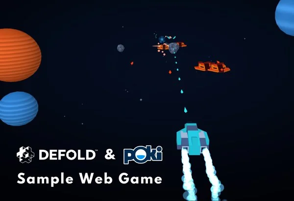

A complete 3D space shooter made with Poki, showing best practices for web games.

[Read more](https://forum.defold.com/t/starbreaker-open-source-full-sample-3d-web-game-for-poki/83355)

## New games made with Defold:

	

		
		

			<h5><a href="https://store.steampowered.com/app/5314810/Thrust_The_Hunt">THRUST: The Hunt</a></h5>
			
<em>by ZIG GAMES</em>

			
Explore, upgrade, defend, hunt.

			
<a href="https://store.steampowered.com/app/5314810/Thrust_The_Hunt">Wishlist it on Steam</a>

		

	

	

		
		

			<h5><a href="https://poki.com/en/g/astrohit">Astrohit</a></h5>
			
<em>by Son of a Byte</em>

			
Platformer meets lunar lander.

			
<a href="https://poki.com/en/g/astrohit">Play on Poki</a>

		

	

	

		<a href="https://store.steampowered.com/app/4836460/Portentum/">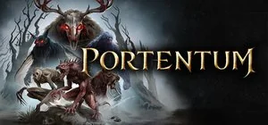</a>
		

			<h5><a href="https://store.steampowered.com/app/4836460/Portentum/">Portentum</a></h5>
			
<em>by Snowfall Games</em>

			
Cryptid deck-building auto battler.

			
<a href="https://store.steampowered.com/app/4836460/Portentum/">Wishlist it on Steam</a>

		

	

	

		
		

			<h5><a href="https://poki.com/en/g/build-a-bud">Build a Bud</a></h5>
			
<em>by Kuyi Mobile</em>

			
New game for younger players.

			
<a href="https://poki.com/en/g/build-a-bud">Play on Poki</a>

		

	

	

		
		

			<h5><a href="https://estelgames.itch.io/ash-islands">Ash Islands</a></h5>
			
<em>by Estel</em>

			
Start with one match, burn the whole island.

			
<a href="https://estelgames.itch.io/ash-islands">Play on itch.io</a>

		

	

	

		
		

			<h5><a href="https://wavedash.com/games/dopaminer">Dopaminer</a></h5>
			
<em>by Fatal Exit</em>

			
Block-breaking incremental game.

			
<a href="https://wavedash.com/games/dopaminer">Play on Wavedash</a>

		

	

## Assets, extensions and tools:

	

		<a href="https://defold.com/assets/microvania-toolkit/">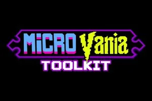</a>
		

			<h5><a href="https://defold.com/assets/microvania-toolkit/">MicroVania Toolkit</a></h5>
			
<em>by Michael Swisher</em>

			
Tiled toolkit for metroidvanias.

		

	

	

		
		

			<h5><a href="https://defold.com/assets/crowd/">Defold Crowd</a></h5>
			
<em>by Selim Anaç</em>

			
2D crowd avoidance for agents.

		

	

	

		<a href="https://defold.com/assets/kabocha-game/">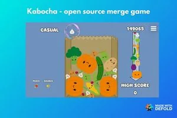</a>
		

			<h5><a href="https://defold.com/assets/kabocha-game/">Kabocha Game</a></h5>
			
<em>by Michael Swisher</em>

			
Open-source Suika-style merge game.

		

	

	

		<a href="https://defold.com/assets/panthera/">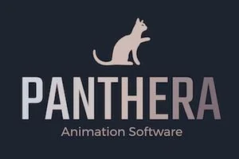</a>
		

			<h5><a href="https://defold.com/assets/panthera/">Panthera</a></h5>
			
<em>by Insality</em>

			
New updates.

		

	

	

		<a href="https://defold.com/assets/reforge/">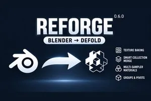</a>
		

			<h5><a href="https://defold.com/assets/reforge/">Reforge 0.6.0</a></h5>
			
<em>by Alexander Bulatov</em>

			
Blender scene exporter.

		

	

	

		<a href="https://defold.com/assets/browser-io/">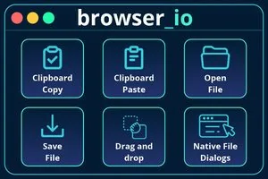</a>
		

			<h5><a href="https://defold.com/assets/browser-io/">Browser_io</a></h5>
			
<em>by Andrew Fowler</em>

			
HTML5 clipboard &amp; files.

		

	

## Worth reading:

##### Defold on Xbox in the news

Coverage from [Windows Central](https://www.windowscentral.com/gaming/xbox/xbox-just-gained-support-for-defold-game-engine), [Pure Xbox](https://www.purexbox.com/news/2026/10/xbox-officially-adds-support-for-a-modern-powerful-and-production-ready-game-engine), [GameFromScratch](https://gamefromscratch.com/defold-engine-now-on-xbox-ps-and-switch/), [Indie Tooling](https://indietooling.com/posts/defold-1-14-xbox-support), [GameBusiness.jp](https://www.gamebusiness.jp/article/2026/10/13/28299.html) and [TodoJuegos](https://todojuegos.com/noticia-30680/Xbox-suma-el-motor-gratuito-Defold-nacido-en-King-el-estudio-de-Candy-Crush).

##### [Snowfall Games on building Portentum with Defold](https://bossrush.net/2026/09/pax-west-2026-interview-with-snowfall-games-co-founder-jaden-holladay-about-portentum/)

[PAX West interview](https://bossrush.net/2026/09/pax-west-2026-interview-with-snowfall-games-co-founder-jaden-holladay-about-portentum/) with co-founder Jaden Holladay, plus their [dev blog](https://snowfall.games/blog).

_by Boss Rush Network_

##### [How I Usually Structure My Defold Games](https://orenjispark.com/blog/posts/how-i-usually-structure-defold-games)

A practical look at organizing Defold projects with Lua modules, a service locator and an event bus.

_by OrenjiSpark_

##### [Learning Defold #1: Game Objects, State, URLs, and Message Passing](https://medium.com/@vladny.fiver/learning-defold-game-objects-state-urls-and-message-passing-588e4aaf9382)

First part of a beginner series on Defold's core concepts.

_by NV_

##### [Making Sense of the Defold Logical Workflow](https://forum.defold.com/t/making-sense-of-the-defold-logical-workflow/83359)

A Godot developer shares how he structures a growing Defold project with modules and messages.

_by svalinn85_

## Worth watching:

	

		<a href="https://www.youtube.com/watch?v=ov3Na13h1us">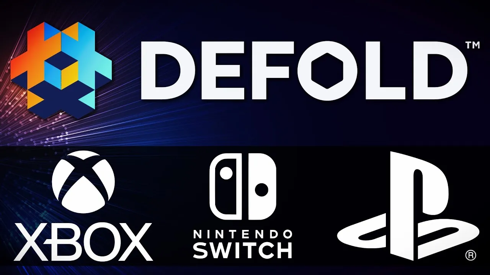</a>
		

			<h5><a href="https://www.youtube.com/watch?v=ov3Na13h1us">Defold Engine - Now On Xbox, PlayStation &amp; Switch</a></h5>
			
<em>by Gamefromscratch</em>

			
A look at Defold's arrival on Xbox, alongside PlayStation and Switch support.

		

	

	

		
		

			<h5><a href="https://www.youtube.com/watch?v=Gfnzmacm1eI">Defold 1.14.0 Release Review</a></h5>
			
<em>by Asatte Games</em>

			
A walkthrough of the features and changes in Defold 1.14.0.

		

	

	

		<a href="https://www.youtube.com/watch?v=BTG34sf5Geg">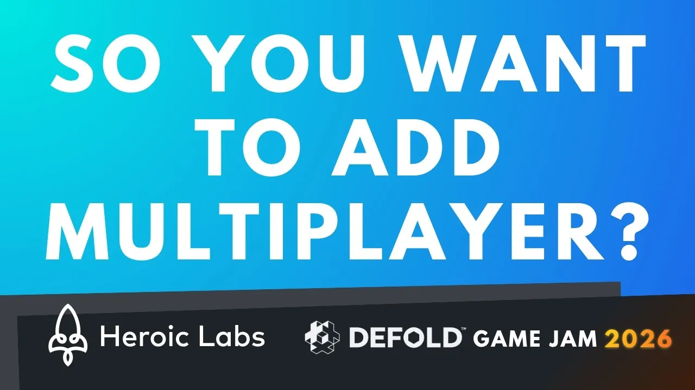</a>
		

			<h5><a href="https://www.youtube.com/watch?v=BTG34sf5Geg">Multiplayer with Heroic Labs</a></h5>
			
<em>by Defold</em>

			
Recording of a talk about multiplayer.

		

	

## Defold 1.14.1 BETA is out

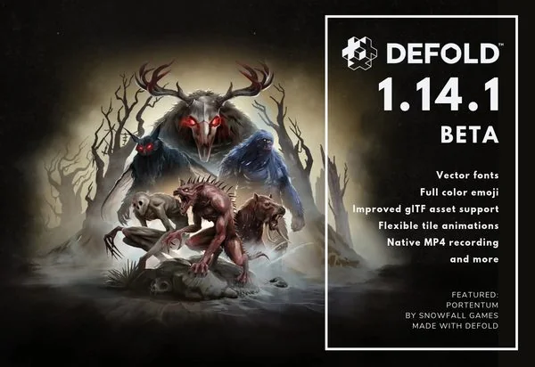

Defold 1.14.1 BETA is out, with new text features, faster effects, and more tools for 3D assets, HTML5 and recording.

Highlights:

- 🔤 Vector fonts & colorful emojis support 🥳
- 🎆 Faster particle rendering
- 🎞️ Flexible tile animations
- ⏺️ Native MP4 recording
- 🔀 SIMD texture-processing optimizations
- 🌐 HTML5 improvements and rendering control
- 📦 Improved glTF support and way more!

[CHECK THE BETA ANNOUNCEMENT](https://forum.defold.com/t/defold-1-14-1-beta/83389)

## Help Defold grow!

Support the Defold Foundation and help us cover operational costs. Donations help pay for the native extension build servers, which are provided completely free of charge to everyone.

[SUPPORT DEFOLD 🧡](https://defold.com/donate/)
