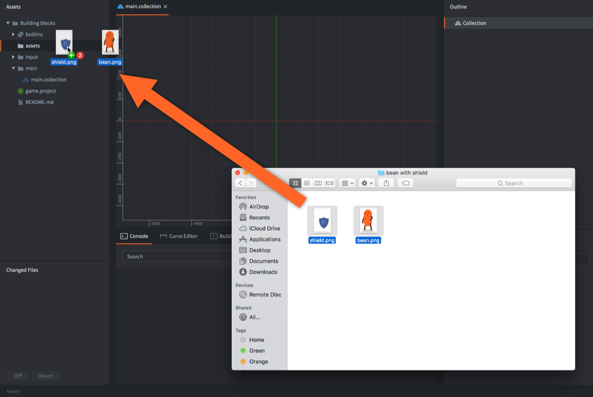
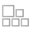
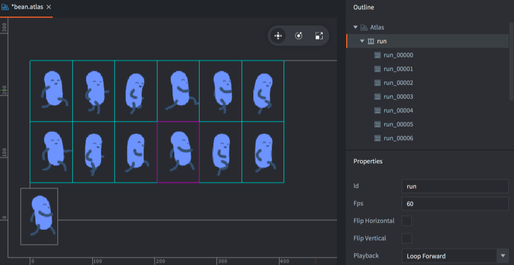
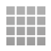
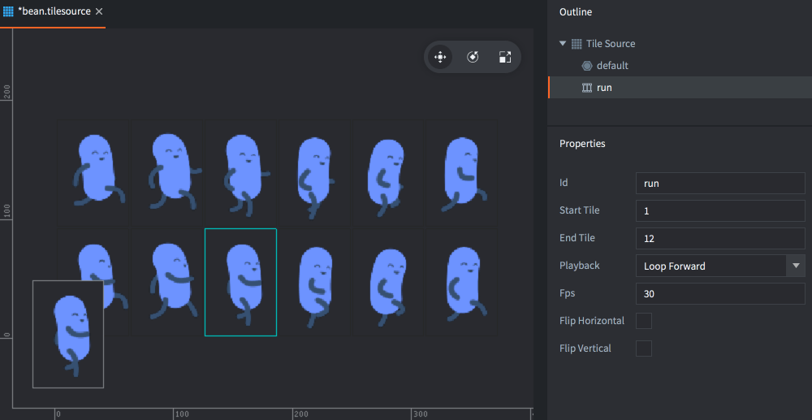
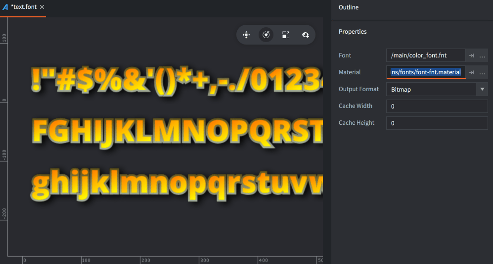
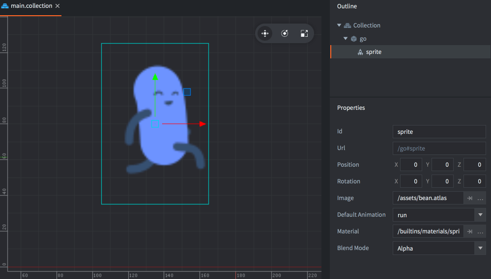
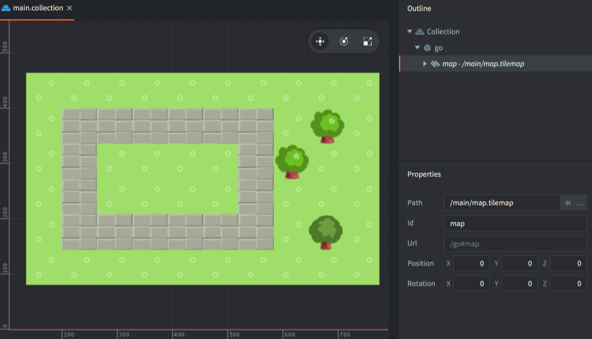
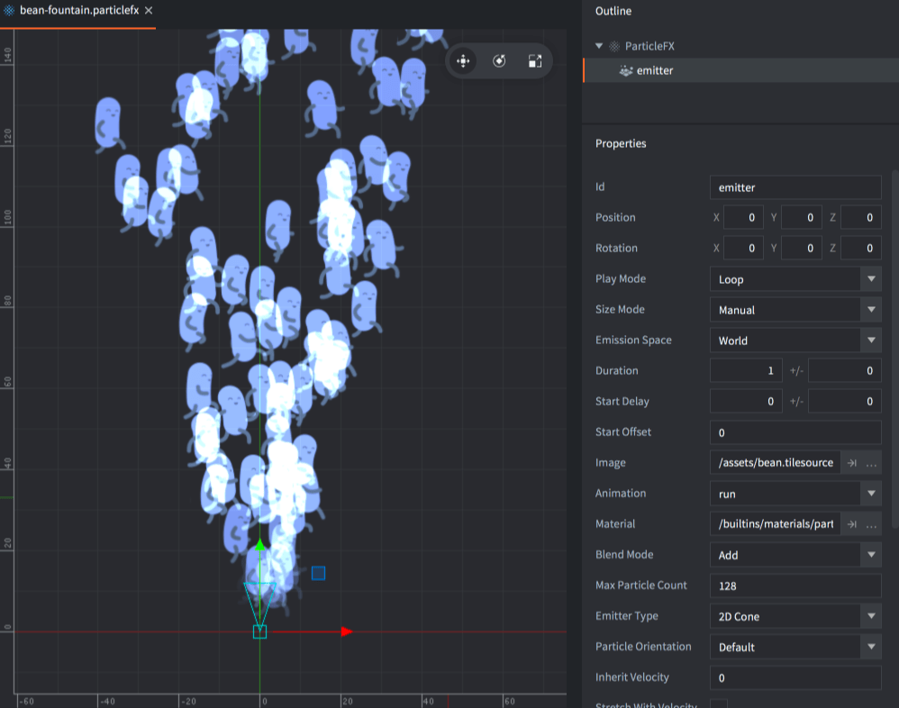
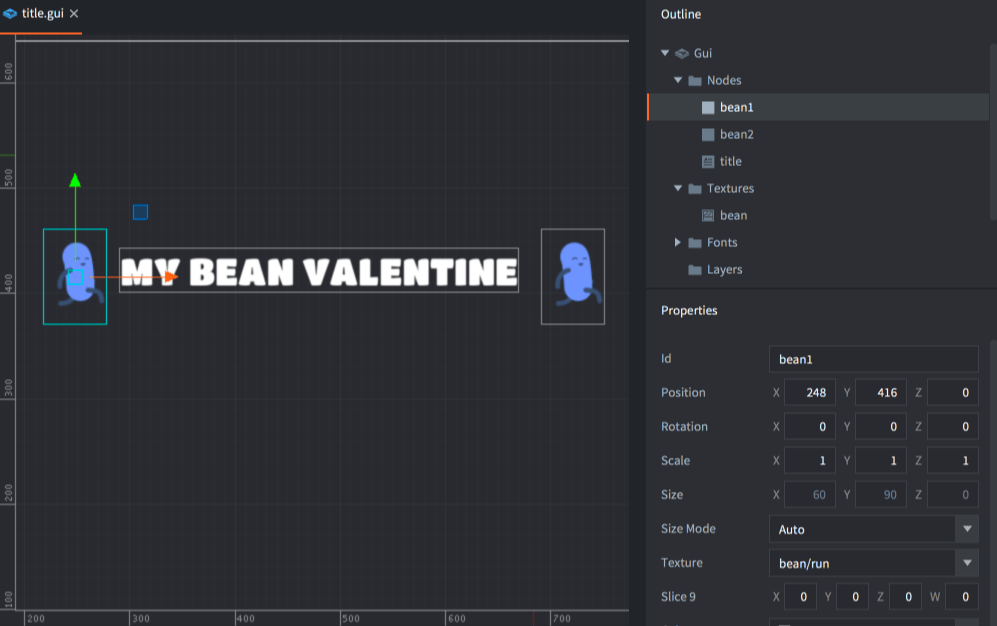

# 2D-Grafiken importieren {#importing-2d-graphics}

Defold unterstützt viele Arten visueller Komponenten (components), die häufig in 2D-Spielen verwendet werden. Mit Defold kannst du statische und animierte Sprites, UI-Komponenten, Partikeleffekte, Kachelkarten (tile maps) und Bitmap-Schriften erstellen. Bevor du eine dieser visuellen Komponenten erstellen kannst, musst du Bilddateien mit den gewünschten Grafiken importieren. Ziehe dazu einfach die Dateien aus dem Dateisystem deines Computers an eine geeignete Stelle im Bereich *Assets* des Defold-Editors und lege sie dort ab.

Verwende PNG- oder JPEG-Bilder für Atlanten und Kachelquellen. Auch KTX2-Quelltexturen können zur Verwendung als Modelltexturen importiert werden; siehe unten.

## KTX2-Texturen {#ktx2-textures}

Importiere eine eigenständige *.ktx2*-Datei, indem du sie in den Bereich *Assets* ziehst, und weise sie anschließend dem Texturfeld eines Materials einer Modellkomponente zu. [glTF- und GLB-Modelle](/de/manuals/importing-models/#ktx2-textures) können ebenfalls externe KTX2-Dateien referenzieren oder eingebettete KTX2-Bilder enthalten. Eingaben für Atlanten, Kachelquellen und Cubemap-Flächen verwenden weiterhin ihre bisherigen Bildformate.

Unterstützte KTX2-Eingaben sind 2D-Texturen mit ETC1S/BasisLZ, UASTC, BC7 oder 8-Bit-R/RG/RGB/RGBA-Daten in UNORM oder sRGB. KTX2-Arrays, Cubemaps, Volumen- und HDR-Texturen werden nicht unterstützt. KTX2 wird beim Build in Defolds *.texturec*-Ressourcen umgewandelt; die Laufzeitumgebung liest keine KTX2-Container.

Öffne ein KTX2-Asset, um Quellformat, Abmessungen, Farbraum, Alpha-Metadaten und Mipmap-Stufen zu untersuchen. In *Outline* kannst du einzelne vorgegebene Mipmap-Stufen auswählen. Diese zeigen die Quellbilder auch dann, wenn ein Texturprofil die kompilierte Textur skaliert oder ihre Mipmaps deaktiviert.

Wähle über [Texturprofile](/de/manuals/texture-profiles/#ktx2-source-textures), ob das Quellformat erhalten oder in andere Formate umgewandelt wird. Wähle Ausgabeformate, die deine Zielgeräte unterstützen. Eine erneute Komprimierung einer bereits verlustbehafteten Quelle kann die Qualität weiter reduzieren, auch wenn **Keep KTX2 Format** nach der Bildverarbeitung eine erneute Kodierung erfordert.

## Defold-Assets erstellen {#creating-defold-assets}

Nachdem du die Bilder in Defold importiert hast, kannst du daraus Defold-spezifische Assets erstellen:

 Atlas
: Ein Atlas enthält eine Liste einzelner Bilddateien, die automatisch zu einem größeren Texturbild zusammengefügt werden. Atlanten können unbewegte Bilder und *Animationsgruppen (Animation Groups)* enthalten. Das sind Bildfolgen, die zusammen eine Flipbook-Animation bilden.

  

Mehr über die Atlas-Ressource erfährst du im [Atlas-Handbuch](/de/manuals/atlas).

 Kachelquelle
: Eine Kachelquelle (tile source) verweist auf eine Bilddatei, die bereits aus kleineren Teilbildern besteht, die in einem gleichmäßigen Raster angeordnet sind. Ein weiterer gebräuchlicher Begriff für diese Art zusammengesetzter Bilder ist _Sprite-Bogen (sprite sheet)_. Kachelquellen können Flipbook-Animationen enthalten, die durch die erste und letzte Kachel der Animation definiert werden. Du kannst außerdem ein Bild verwenden, um Kacheln automatisch Kollisionsformen zuzuordnen.

  

Mehr über die Kachelquellen-Ressource erfährst du im [Handbuch zu Kachelquellen](/de/manuals/tilesource).

 Bitmap-Schrift
: Bei einer Bitmap-Schrift (bitmap font) befinden sich die Glyphen in einem PNG-Schriftbogen. Diese Schriftarten bieten keinen Leistungsvorteil gegenüber Schriftarten, die aus TrueType- oder OpenType-Schriftdateien erzeugt werden. Sie können jedoch beliebige Grafiken, Farben und Schatten direkt im Bild enthalten.

Mehr über Bitmap-Schriften erfährst du im [Handbuch zu Schriftarten](/de/manuals/font/#bitmap-bmfonts).

  

## Defold-Assets verwenden {#using-defold-assets}

Wenn du die Bilder in Atlas- und Kachelquellendateien umgewandelt hast, kannst du daraus verschiedene Arten visueller Komponenten erstellen:

: Ein Sprite ist entweder ein statisches Bild oder eine Flipbook-Animation, die auf dem Bildschirm angezeigt wird.

  

Mehr über Sprites erfährst du im [Sprite-Handbuch](/de/manuals/sprite).

 Kachelkarte
: Eine Kachelkartenkomponente setzt eine Karte aus Kacheln (Bild und Kollisionsformen) zusammen, die aus einer Kachelquelle stammen. Kachelkarten können keine Atlanten als Quelle verwenden.

  

Mehr über Kachelkarten erfährst du im [Handbuch zu Kachelkarten](/de/manuals/tilemap).

 Partikeleffekt
: Partikel, die ein Partikelemitter erzeugt, bestehen aus einem unbewegten Bild oder einer Flipbook-Animation aus einem Atlas oder einer Kachelquelle.

  

Mehr über Partikeleffekte erfährst du im [Handbuch zu Partikeleffekten](/de/manuals/particlefx).

 GUI
: Box-Knoten und Kreissektor-Knoten einer GUI können unbewegte Bilder und Flipbook-Animationen aus Atlanten und Kachelquellen verwenden.

  

Mehr über GUIs erfährst du im [GUI-Handbuch](/de/manuals/gui).