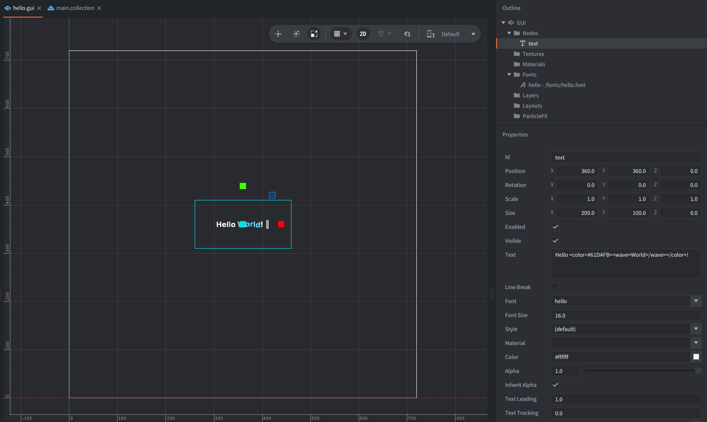

---
author_ids:
- defold-foundation
brief: This example shows how to use vector fonts, Rich Text effects and full-color emoji.
category: gui
layout: example
opengraph_image: https://www.defold.com/examples/gui/vector_emoji_rich_text/thumbnail.webp
path: gui/vector_emoji_rich_text
scripts: hello.gui_script
tags: font, gui, animation
thumbnail: thumbnail.webp
title: Vector Fonts, Rich Text and Emoji
twitter_image: https://www.defold.com/examples/gui/vector_emoji_rich_text/thumbnail.webp

---

This example shows how to combine vector fonts, Rich Text effects and full-color emoji in a single Defold GUI text node.

The text displays a text and emojis with example Rich Text tags for changing size, color, or gradients.
An emoji changes every second.
The entire text gently zooms in and out using sine easing.

## Setup

The scene contains just one game object, `go`, with a GUI component:

- The GUI contains one text node named `text`, positioned in the center.
- The GUI uses the accompanying GUI script `hello.gui_script` to set and animate the text.
- The GUI has a vector font registered with the name `hello`.
- The example includes `Twemoji-COLRv1.ttf` for full-color emoji.

It's also important to enable full text layout system and Rich Text in the custom App Manifest:

## How it works

1. In `init()` get the `hello` font resource
2. Add the COLRv1 emoji font with `font.add_font()`
3. Prewarm the glyphs with `font.prewarm_text()`.
2. When prewarming completes, `on_prewarmed()` sets the Rich Text string on the `text` node and starts a looping zoom animation with `gui.animate()` and `gui.EASING_INOUTSINE`.
3. In `update()` we change the emoji every second, cycling through rocket, smile, wink and thumbs up.

The Rich Text markup uses `<color>`, `<wave>`, `<shake>`, `<size>` and `<gradient>` to style and animate portions of the text without creating extra nodes.
Read more about Rich Text tags in [the Rich Text markup manual](https://defold.com/manuals/font-richtext/).

Credits
Inter font files: SIL Open Font License 1.1.
Emoji glyphs: derived from Twemoji Mozilla, CC BY 4.0
Source links in `licenses/`.