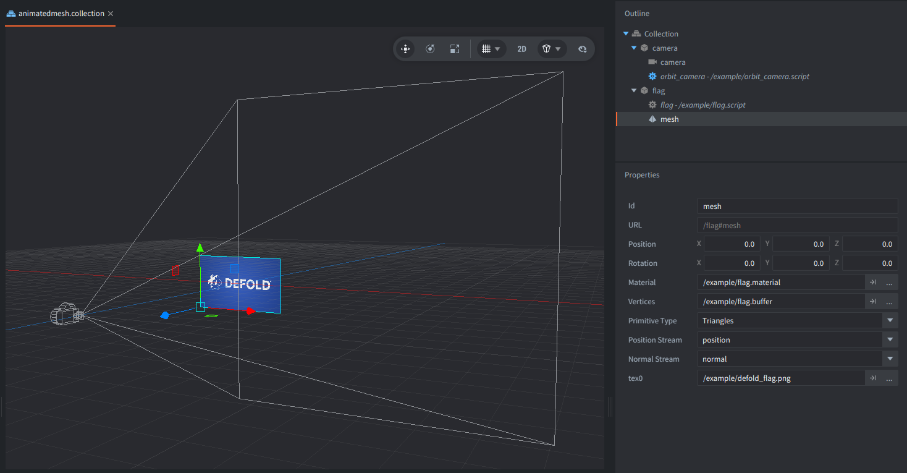

---
author_ids:
- defold-foundation
brief: This example shows how to create and animate a textured mesh component in the shape of a rectangle.
category: mesh
layout: example
opengraph_image: https://www.defold.com/examples/mesh/animated/thumbnail.webp
path: mesh/animated
scripts: flag.script, flag.fp, flag.vp
tags: mesh
thumbnail: thumbnail.webp
title: Animated Mesh - Flag
twitter_image: https://www.defold.com/examples/mesh/animated/thumbnail.webp

---

This is a small Defold example showing how to create and animate textured meshes to create a waving flag. It shows how to animate an existing textured mesh without creating new buffers or using a physics simulation.

Use a mouse or touch to move the camera around. 

# Setup

The flag mesh is defined in `flag.buffer` resource file and consists of a grid of triangles with position, normal, and texture coordinate streams forming a rectangle.
The texture is assigned directly to the Mesh component.

The mesh is attached in the example collection to a game object with the `flag.script` that controls the animation of the vertices.

Additionally, the camera with `orbit_camera.script` is in the collection to control the view.

# How it works?

In `flag.script`, call to `resource.get_buffer()` allows us to retrieve the existing mesh buffer, and `buffer.get_stream()` provides access to its vertex positions and normals.

Each frame, a sine wave modifies the Z coordinates of the vertices to simulate fabric waving in the wind. The wave amplitude increases toward the free edge of the flag, keeping the opposite edge fixed.

The vertex normals are also updated to maintain smooth lighting as the mesh deforms. The data that is modified each frame is then updated in the mesh using `resource.set_buffer()`.

A custom material and shaders (`flag.vp` and `flag.fp`) handle texture sampling and directional lighting. A perspective camera allows to see the animated mesh in 3D.