# 2D グラフィックスのインポート {#importing-2d-graphics}

Defold は、2D ゲームでよく使われるさまざまな種類の描画用コンポーネント（component）をサポートしています。Defold では、静止したスプライト（sprite）やアニメーションするスプライト、UI コンポーネント、パーティクルエフェクト（particle effect）、タイルマップ（tile map）、ビットマップフォント（bitmap font）を作成できます。これらの描画用コンポーネントを作成するには、まず使用するグラフィックスを含む画像ファイルをインポートする必要があります。画像ファイルをインポートするには、コンピューター上のファイルシステムからファイルをドラッグし、Defold エディターの *Assets ペイン* 内の適切な場所にドロップするだけです。

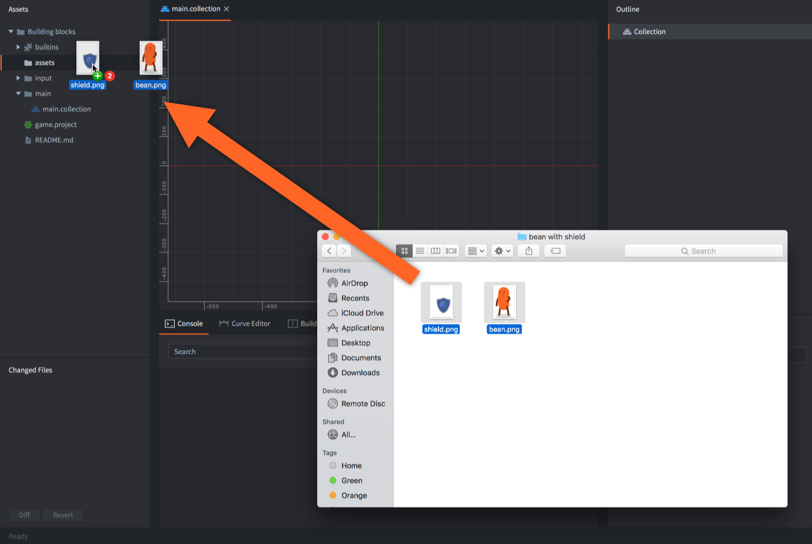

アトラスとタイルソースには、PNG または JPEG 画像を使います。モデルのテクスチャとして使う KTX2 ソーステクスチャもインポートできます。以下を参照してください。

## KTX2 テクスチャ {#ktx2-textures}

単独の *.ktx2* ファイルを *Assets* ペインにドラッグしてインポートし、Model コンポーネントのマテリアルのテクスチャフィールドに割り当てます。[glTF および GLB モデル](/ja/manuals/importing-models/#ktx2-textures)は、外部の KTX2 ファイルを参照したり、KTX2 画像を埋め込んだりできます。アトラス、タイルソース、キューブマップの各面の入力には、引き続き従来の画像形式を使います。

対応する KTX2 入力は、ETC1S/BasisLZ、UASTC、BC7、または8ビットの R/RG/RGB/RGBA UNORM もしくは sRGB データを使った 2D テクスチャです。KTX2 の配列、キューブマップ、ボリューム、HDR テクスチャには対応しません。KTX2 はビルド時に Defold の *.texturec* リソースに処理され、ランタイムは KTX2 コンテナーを読みません。

KTX2 アセットを開くと、ソースの形式、寸法、色空間、アルファのメタデータ、ミップレベルを調べられます。*Outline* では、作成済みの各ミップレベルを選択できます。テクスチャプロファイルがコンパイル後のテクスチャをリサイズしたり、ミップマップを無効にしたりしても、ここにはソース画像が表示されます。

[テクスチャプロファイル](/ja/manuals/texture-profiles/#ktx2-source-textures)で、ソース形式を保持するか、ほかの形式に変換するかを選択します。対象デバイスが対応する出力形式を選んでください。すでに非可逆圧縮されたソースの再圧縮は、さらに品質を低下させることがあります。画像処理後に **Keep KTX2 Format** が再エンコードを必要とする場合も同様です。

## Defold アセットの作成 {#creating-defold-assets}

Defold に画像をインポートすると、その画像を使って Defold 固有のアセット（asset）を作成できます。

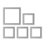 アトラス
: アトラス（atlas）には個別の画像ファイルのリストが含まれ、それらの画像はより大きなテクスチャ画像に自動的にまとめられます。アトラスには静止画像と、連続した画像を切り替えるフリップブックアニメーション（flipbook animation）を構成する画像の集合である *アニメーショングループ（Animation Groups）* を含められます。

  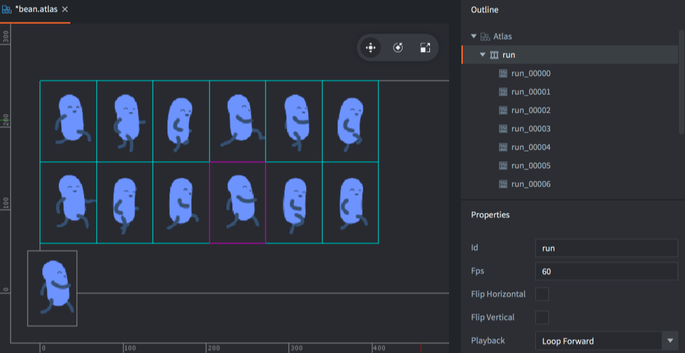

アトラスリソースについて詳しくは、[アトラスのマニュアル](/ja/manuals/atlas)を参照してください。

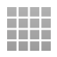 タイルソース
: タイルソース（tile source）は、小さな画像を均一なグリッドに並べて構成した画像ファイルを参照します。このように複数の画像をまとめた画像は、一般に _スプライトシート（sprite sheet）_ とも呼ばれます。タイルソースには、アニメーションの最初と最後のタイルで定義するフリップブックアニメーションを含められます。また、画像を使ってタイルにコリジョン形状（collision shape）を自動的に付加することもできます。

  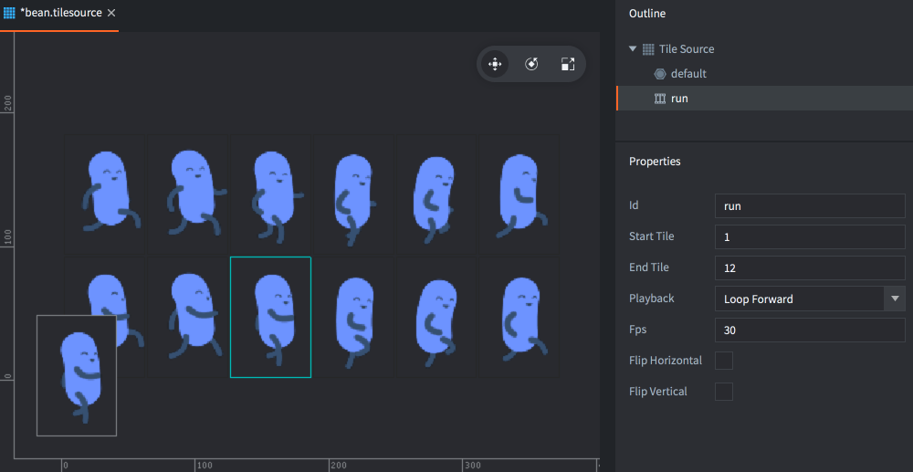

タイルソースリソースについて詳しくは、[タイルソースのマニュアル](/ja/manuals/tilesource)を参照してください。

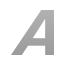 ビットマップフォント
: ビットマップフォントは、PNG 形式のフォントシートにグリフ（glyph）を格納します。この種類のフォントは、TrueType または OpenType のフォントファイルから生成したフォントと比べてパフォーマンスは向上しませんが、任意のグラフィックス、色、影を画像に直接含められます。

ビットマップフォントについて詳しくは、[フォントのマニュアル](/ja/manuals/font/#bitmap-bmfonts)を参照してください。

  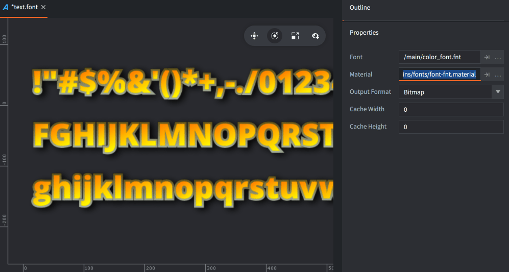

## Defold アセットの使用 {#using-defold-assets}

画像をアトラスファイルとタイルソースファイルに変換すると、それらを使ってさまざまな種類の描画用コンポーネントを作成できます。

: スプライトは、画面に表示する静止画像またはフリップブックアニメーションです。

  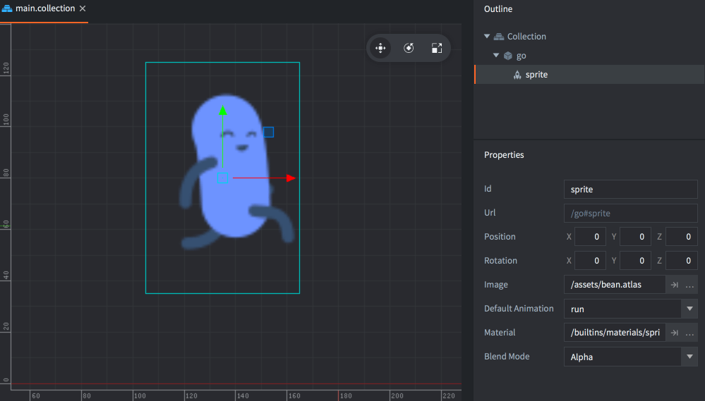

スプライトについて詳しくは、[スプライトのマニュアル](/ja/manuals/sprite)を参照してください。

 タイルマップ
: タイルマップコンポーネントは、タイルソースから取得したタイル（画像とコリジョン形状）を組み合わせてマップを作成します。タイルマップではアトラスをソースとして使用できません。

  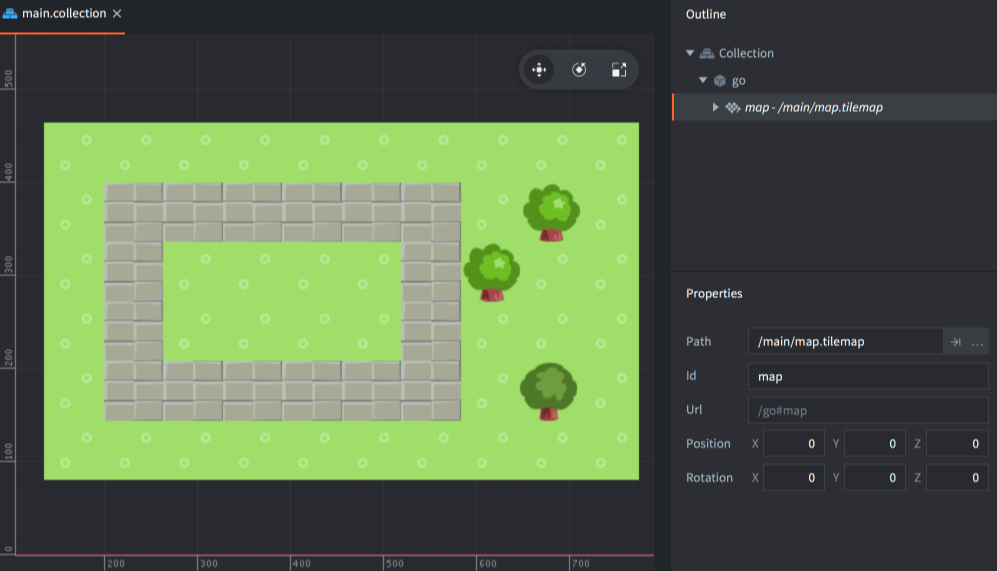

タイルマップについて詳しくは、[タイルマップのマニュアル](/ja/manuals/tilemap)を参照してください。

 パーティクルエフェクト
: パーティクルエミッター（particle emitter）から生成されるパーティクルは、アトラスまたはタイルソースの静止画像またはフリップブックアニメーションで構成されます。

  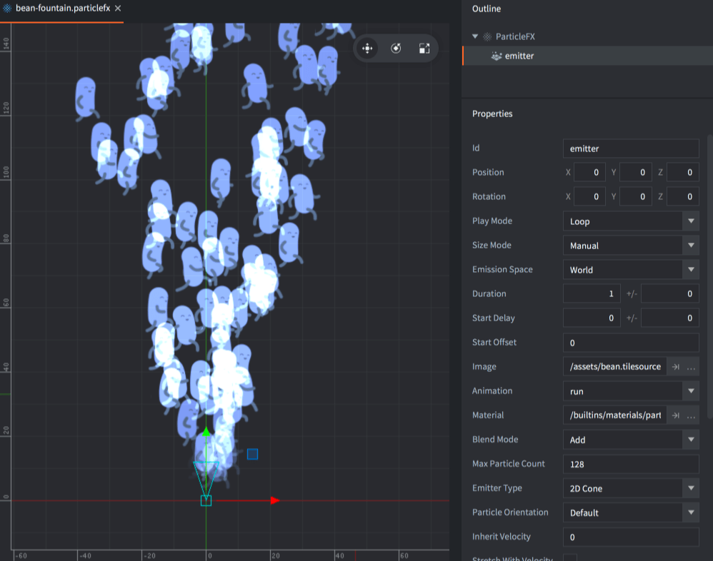

パーティクルエフェクトについて詳しくは、[パーティクルエフェクトのマニュアル](/ja/manuals/particlefx)を参照してください。

 GUI
: GUI のボックスノード（box node）と、円や扇形を表示するパイノード（pie node）では、アトラスやタイルソースの静止画像とフリップブックアニメーションを使用できます。

  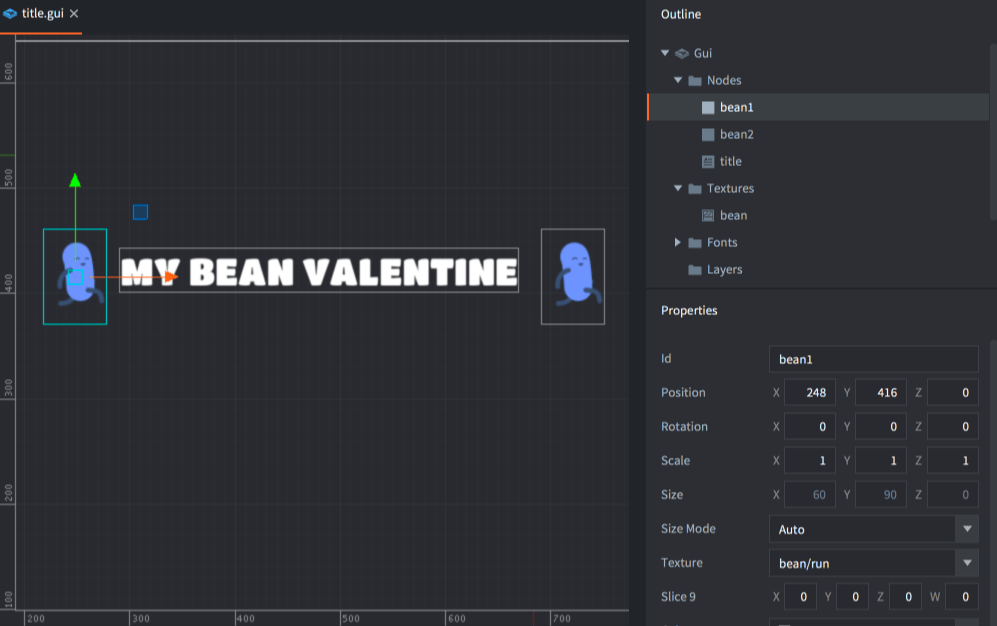

GUI について詳しくは、[GUI のマニュアル](/ja/manuals/gui)を参照してください。