# Importowanie grafiki 2D

Defold obsługuje wiele rodzajów elementów wizualnych często używanych w grach 2D. Defold umożliwia tworzenie statycznych i animowanych sprite'ów, komponentów GUI, efektów cząsteczkowych, map kafelków oraz fontów bitmapowych. Zanim utworzysz którykolwiek z tych elementów wizualnych, musisz zaimportować pliki graficzne, z których chcesz korzystać. Aby to zrobić, przeciągnij pliki z systemu plików na komputerze i upuść je w odpowiednim miejscu w panelu *<kbd>Assets</kbd>* edytora Defold.

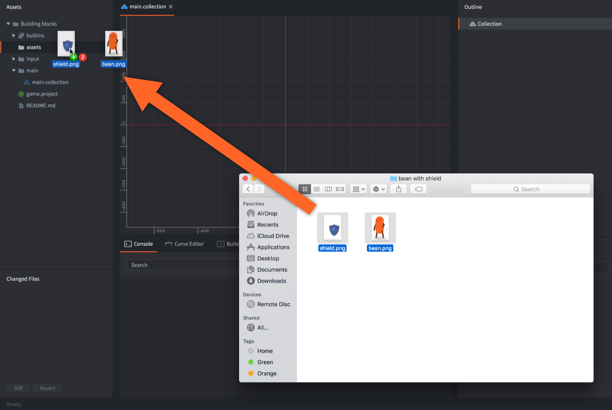

Do atlasów i źródeł kafelków używaj obrazów PNG lub JPEG. Można również importować tekstury źródłowe KTX2 do użycia jako tekstury modeli; szczegóły poniżej.

## Tekstury KTX2 {#ktx2-textures}

Zaimportuj samodzielny plik *.ktx2*, przeciągając go do panelu *Assets*, a następnie przypisz go do pola tekstury materiału w komponencie Model. [Modele glTF i GLB](/pl/manuals/importing-models/#ktx2-textures) mogą również odwoływać się do zewnętrznych plików KTX2 lub zawierać osadzone obrazy KTX2. Atlasy, źródła kafelków i ściany map sześciennych nadal przyjmują dotychczasowe formaty obrazów.

Obsługiwane dane wejściowe KTX2 to tekstury 2D używające ETC1S/BasisLZ, UASTC, BC7 lub 8-bitowych danych R/RG/RGB/RGBA UNORM albo sRGB. Tablice, mapy sześcienne, tekstury wolumetryczne i tekstury HDR w KTX2 nie są obsługiwane. KTX2 jest przetwarzany podczas budowania na zasoby *.texturec* silnika Defold; środowisko uruchomieniowe nie odczytuje kontenerów KTX2.

Otwórz zasób KTX2, aby sprawdzić format źródłowy, wymiary, przestrzeń kolorów, metadane kanału alfa i poziomy mipmap. Widok *Outline* pozwala wybierać poszczególne poziomy mipmap zapisane w pliku. Pokazują one obrazy źródłowe nawet wtedy, gdy profil tekstury zmienia rozmiar skompilowanej tekstury lub wyłącza jej mipmapy.

Użyj [profili teksturowania](/pl/manuals/texture-profiles/#ktx2-source-textures), aby wybrać zachowanie formatu źródłowego albo konwersję do innych formatów. Wybieraj formaty wyjściowe obsługiwane przez urządzenia docelowe. Ponowna kompresja już stratnie skompresowanego źródła może dodatkowo obniżyć jakość, również wtedy, gdy **Keep KTX2 Format** musi ponownie zakodować obraz po jego przetworzeniu.

## Tworzenie zasobów

Po zaimportowaniu obrazów można użyć ich do tworzenia zasobów specyficznych dla Defold:

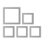 Atlas
: Atlas zawiera listę oddzielnych plików graficznych, które są automatycznie łączone w większą teksturę. Atlasy mogą zawierać obrazy statyczne i *Animation Groups*, czyli zestawy obrazów tworzących animację poklatkową.

  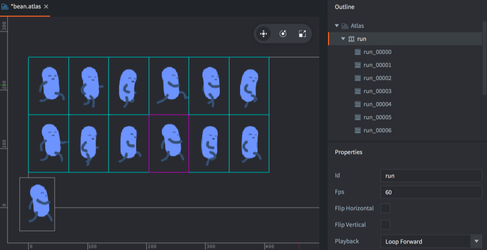

Więcej informacji o zasobie atlasu znajdziesz w [instrukcji atlasu](/pl/manuals/atlas).

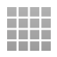 Tile Source
: Tile Source odwołuje się do pliku graficznego, który został już podzielony na mniejsze podobrazy ułożone w regularnej siatce. Innym często używanym określeniem takiego złożonego obrazu jest _sprite sheet_. Tile Source mogą zawierać animacje poklatkowe zdefiniowane przez pierwszy i ostatni kafelek animacji. Można też użyć obrazu do automatycznego dołączania kształtów kolizji do kafelków.

  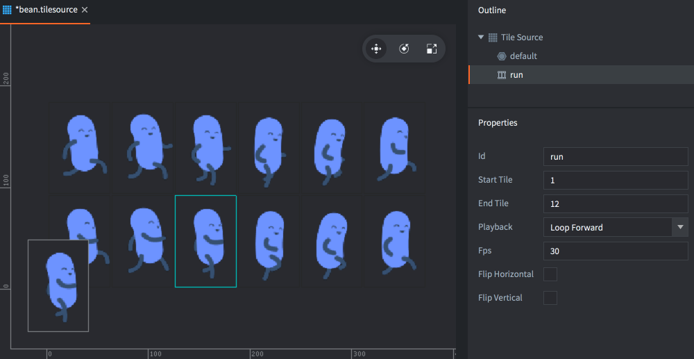

Więcej informacji o zasobie Tile Source znajdziesz w [instrukcji źródła kafelków](/pl/manuals/tilesource).

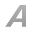 Bitmap Font
: Bitmap Font przechowuje swoje glify w arkuszu fontu PNG. Tego typu fonty nie zapewniają poprawy wydajności względem fontów generowanych z plików TrueType lub OpenType, ale mogą zawierać dowolną grafikę, kolory i cienie bezpośrednio w obrazie.

Więcej informacji o fontach bitmapowych znajdziesz w [instrukcji fontów](/pl/manuals/font/#bitmap-bmfonts).

  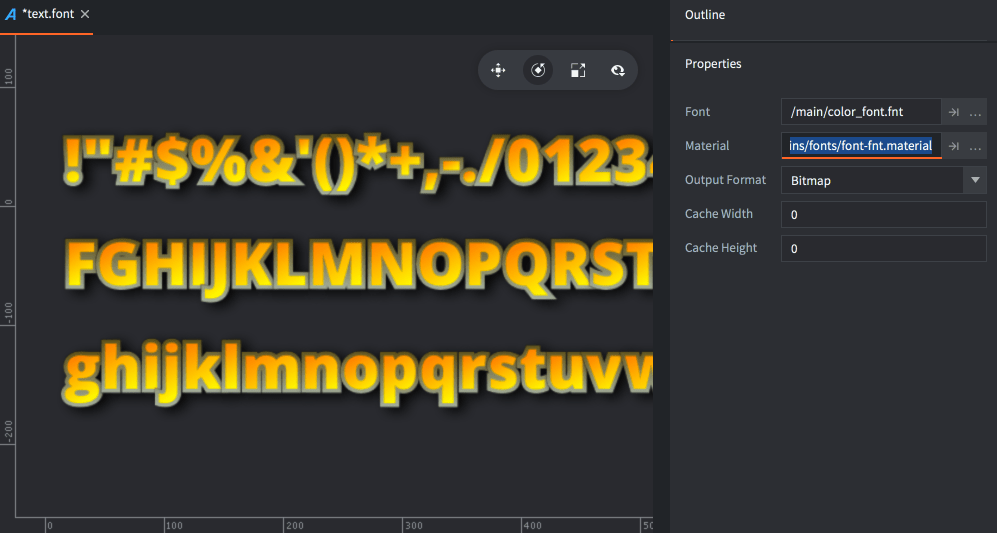

## Używanie zasobów

Gdy przekonwertujesz obrazy na pliki Atlas i Tile Source, możesz używać ich do tworzenia kilku różnych rodzajów elementów wizualnych:

: Sprite to statyczny obraz albo animacja poklatkowa wyświetlana na ekranie.

  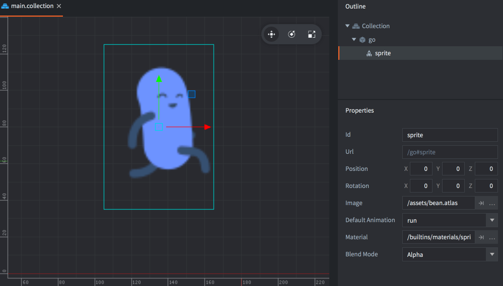

Więcej informacji o sprite'ach znajdziesz w [instrukcji sprite'ów](/pl/manuals/sprite).

 Tile map
: Komponent tile map buduje mapę z kafelków, czyli obrazów i kształtów kolizji pochodzących z Tile Source. Tile map nie mogą korzystać z atlasów.

  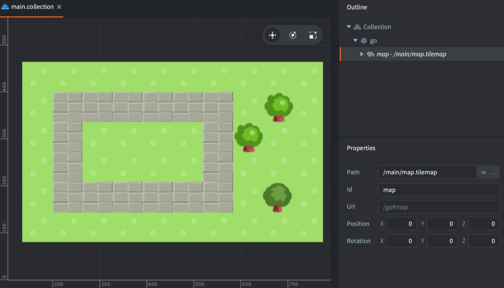

Więcej informacji o tile map znajdziesz w [instrukcji map kafelków](/pl/manuals/tilemap).

 Particle fx
: Cząstki emitowane przez particle emitter mogą składać się ze statycznego obrazu albo animacji poklatkowej z atlasu lub Tile Source.

  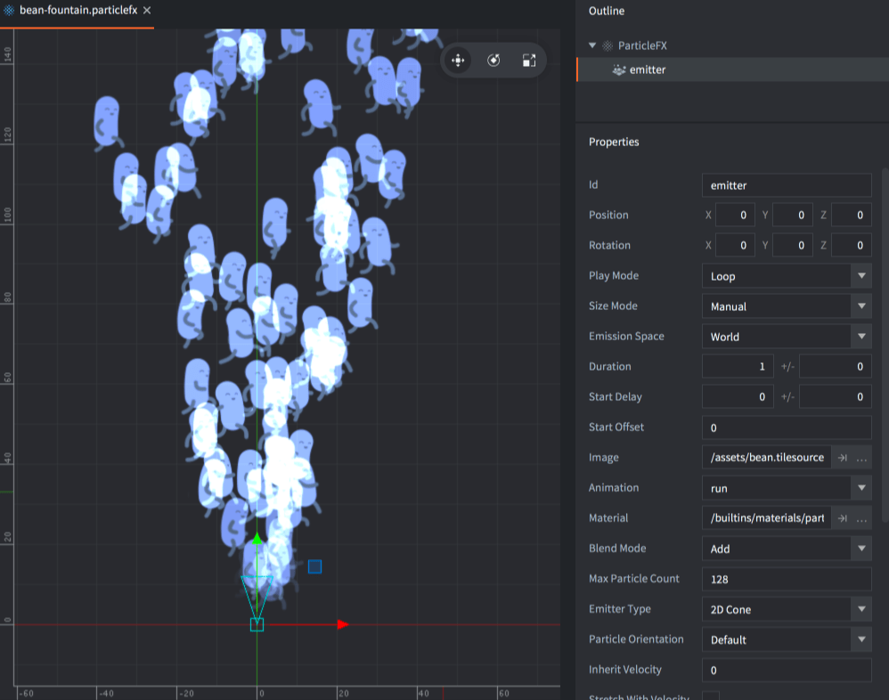

Więcej informacji o efektach cząsteczkowych znajdziesz w [instrukcji efektów Particle fx](/pl/manuals/particlefx).

 GUI
: Węzły GUI typu box i pie mogą używać statycznych obrazów i animacji poklatkowych z atlasów oraz Tile Source.

  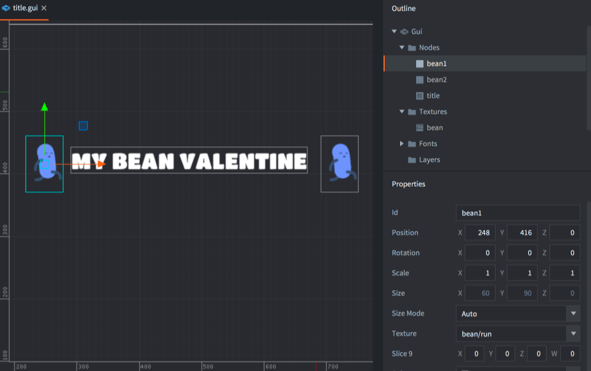

Więcej informacji o GUI znajdziesz w [instrukcji GUI](/pl/manuals/gui).