# Importando gráficos 2D

O Defold oferece suporte a muitos tipos de componentes visuais frequentemente usados em jogos 2D. Você pode usar o Defold para criar sprites estáticos e animados, componentes de UI, efeitos de partículas, tile maps e fontes bitmap. Antes de criar qualquer um desses componentes visuais, você precisa importar arquivos de imagem com os gráficos que deseja usar. Para importar arquivos de imagem, basta arrastar os arquivos do sistema de arquivos do seu computador e soltá-los em um local apropriado no *painel Conteúdo* do editor Defold.

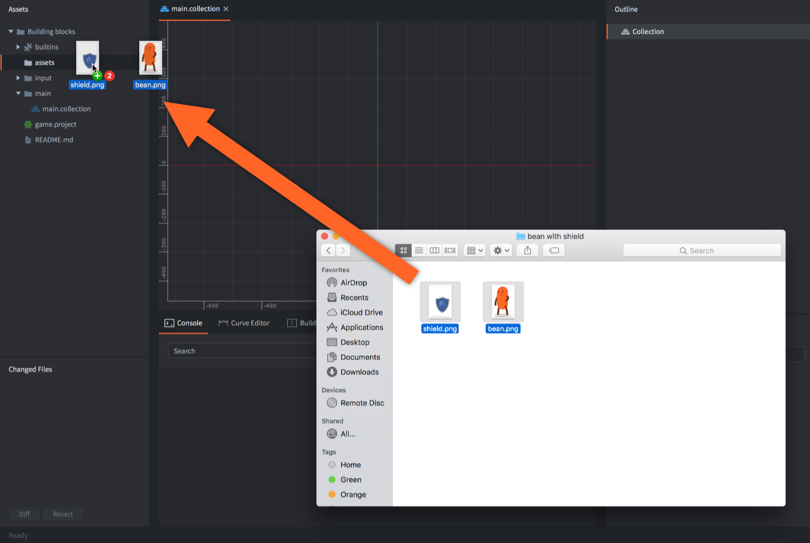

Use imagens PNG ou JPEG para atlases e fontes de tiles. Texturas de origem KTX2 também podem ser importadas para uso como texturas de modelos; veja abaixo.

## Texturas KTX2 {#ktx2-textures}

Importe um arquivo *.ktx2* independente arrastando-o para o painel *Assets* e atribua-o ao campo de textura de material de um componente Model. [Modelos glTF e GLB](/pt/manuals/importing-models/#ktx2-textures) também podem referenciar arquivos KTX2 externos ou conter imagens KTX2 incorporadas. Entradas de atlas, fontes de tiles e faces de cubemap continuam usando seus formatos de imagem existentes.

As entradas KTX2 aceitas são texturas 2D que usam ETC1S/BasisLZ, UASTC, BC7 ou dados R/RG/RGB/RGBA de 8 bits UNORM ou sRGB. Arrays, cubemaps, volumes e texturas HDR KTX2 não são aceitos. KTX2 é processado durante o build em recursos *.texturec* do Defold; o runtime não lê contêineres KTX2.

Abra um asset KTX2 para inspecionar seu formato de origem, dimensões, espaço de cores, metadados alfa e níveis mip. O painel *Outline* permite selecionar os níveis mip individuais criados no arquivo. Eles mostram as imagens de origem mesmo quando um perfil de textura redimensiona a textura compilada ou desabilita seus mipmaps.

Use [perfis de textura](/pt/manuals/texture-profiles/#ktx2-source-textures) para escolher entre manter o formato de origem e convertê-lo para outros formatos. Escolha formatos de saída compatíveis com seus dispositivos-alvo. Recomprimir uma origem que já tem perdas pode reduzir ainda mais a qualidade, inclusive quando **Keep KTX2 Format** precisa recodificar após o processamento da imagem.

## Criando assets do Defold

Quando as imagens são importadas para o Defold, elas podem ser usadas para criar assets específicos do Defold:

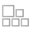 Atlas
: Um atlas contém uma lista de arquivos de imagem separados, que são combinados automaticamente em uma imagem de textura maior. Atlases podem conter imagens estáticas e *Animation Groups*, conjuntos de imagens que juntas formam uma animação flip-book.

  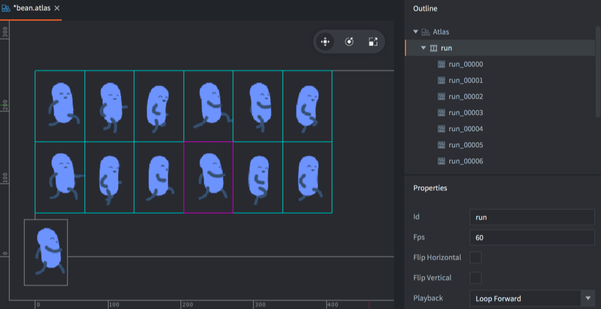

Saiba mais sobre o recurso atlas no [manual de Atlas](/pt/manuals/atlas).

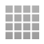 Tile Source
: Um tile source referencia um arquivo de imagem que já foi preparado para consistir em subimagens menores organizadas em uma grade uniforme. Outro termo comumente usado para esse tipo de imagem composta é _sprite sheet_. Tile sources podem conter animações flip-book, definidas pelo primeiro e pelo último tile da animação. Também é possível usar uma imagem para anexar automaticamente formas de colisão aos tiles.

  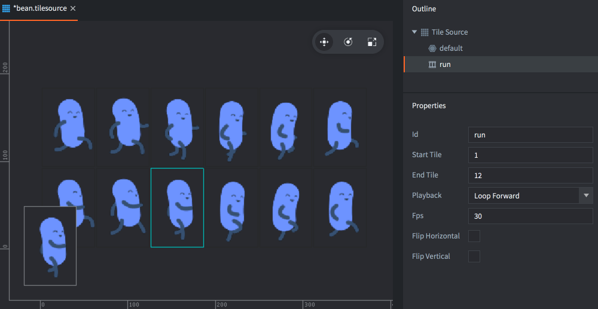

Saiba mais sobre o recurso tile source no [manual de Tile source](/pt/manuals/tilesource).

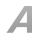 Bitmap Font
: Uma fonte bitmap tem seus glifos em uma folha de fonte PNG. Esses tipos de fonte não oferecem melhoria de desempenho em relação a fontes geradas a partir de arquivos TrueType ou OpenType, mas podem incluir gráficos arbitrários, coloração e sombras diretamente na imagem.

Saiba mais sobre fontes bitmap no [manual de Fontes](/pt/manuals/font/#bitmap-bmfonts).

  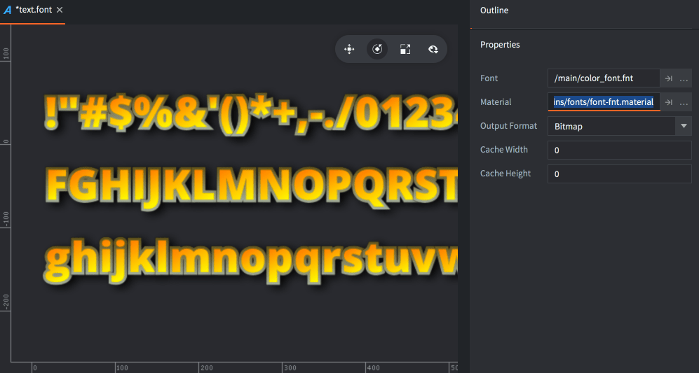

## Usando assets do Defold

Depois de converter as imagens em arquivos Atlas e Tile Source, você pode usá-las para criar vários tipos diferentes de componentes visuais:

: Um sprite é uma imagem estática ou animação flip-book exibida na tela.

  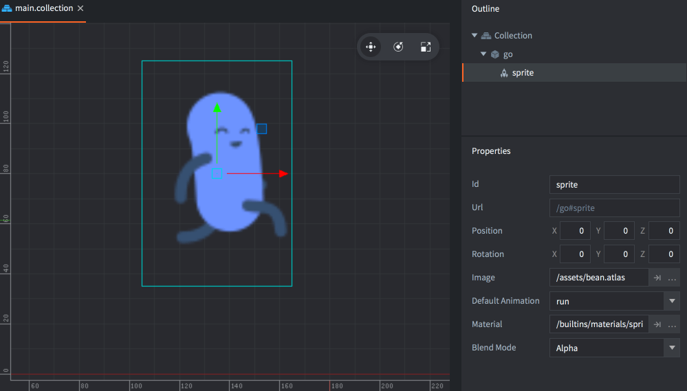

Saiba mais sobre sprites no [manual de Sprite](/pt/manuals/sprite).

 Tile map
: Um componente de tile map monta um mapa a partir de tiles (imagem e formas de colisão) vindos de um tile source. Tile maps não podem usar atlas como origem.

  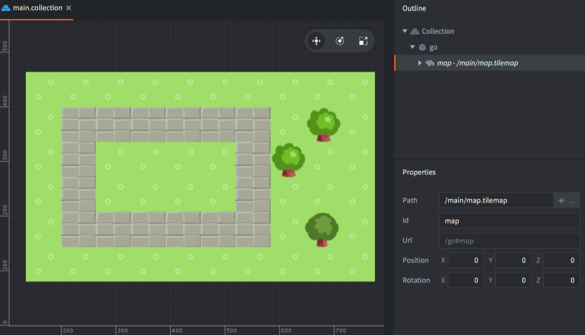

Saiba mais sobre tile maps no [manual de Tilemap](/pt/manuals/tilemap).

 Particle fx
: Partículas geradas por um emissor de partículas consistem em uma imagem estática ou uma animação flip-book de um atlas ou tile source.

  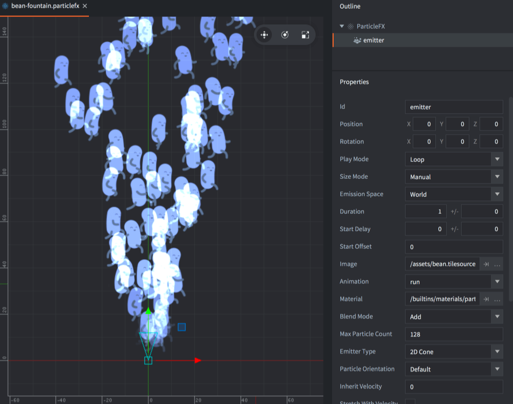

Saiba mais sobre efeitos de partículas no [manual de Particle fx](/pt/manuals/particlefx).

 GUI
: Nodes GUI do tipo box e pie podem usar imagens estáticas e animações flip-book de atlases e tile sources.

  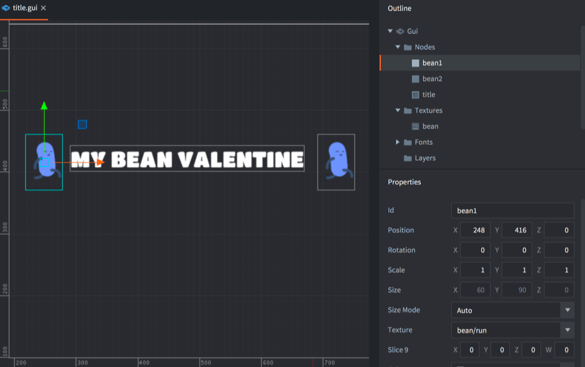

Saiba mais sobre GUIs no [manual de GUI](/pt/manuals/gui).